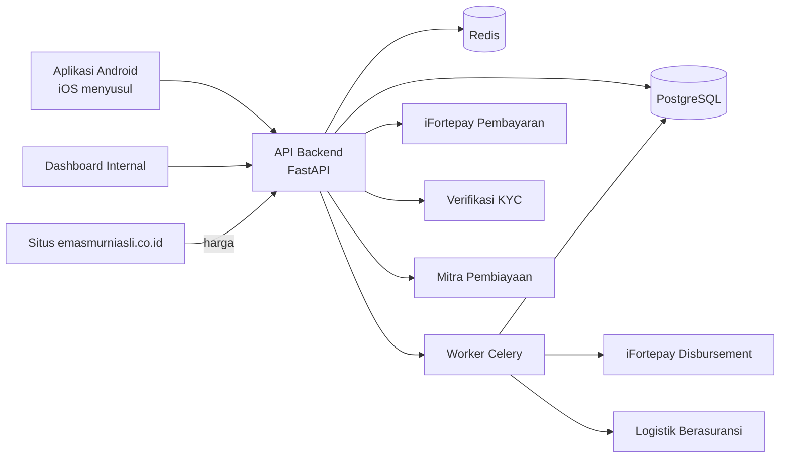

# Usulan Pengembangan Sistem REIDIG

Status: **DRAFT v3**, sudah memuat keputusan manajemen · Tanggal: 3 November 2026

## 1. Ringkasan

**REIDIG** menjual emas digital yang didukung 1:1 oleh **keping emas fisik per SKU** (0,1 gr – 1 kg). Saat membeli, pengguna menerima **token ber-ID unik** yang mengunci satu keping bernomor seri. Saat menjual, token dikembalikan ke sistem, keping kembali menjadi stok tanpa pemilik, dan dana masuk ke saldo aplikasi.

| Komponen | Teknologi |
|---|---|
| Aplikasi mobile | Kotlin + Jetpack Compose. Android dulu, logika bersama disiapkan untuk iOS dengan Kotlin Multiplatform |
| Backend | Python, FastAPI, PostgreSQL, Redis, Celery |
| Dashboard internal | Vite + React + TypeScript |

## 2. Keputusan manajemen dan dampaknya

| # | Keputusan | Dampak pada sistem |
|---|---|---|
| 1 | Izin sudah ada | Tahap perizinan dipersingkat. Cakupan izin perlu dicek terhadap saldo dan stok bersama (§3.1) |
| 2 | Keping dikunci per nomor seri | Sesuai rancangan: 1 token mengunci 1 keping |
| 3 | SKU diperbarui tim gudang lewat dashboard | Dashboard perlu modul kelola SKU; tidak ada daftar SKU tetap di kode |
| 4 | Stok emas digital hanya di gudang Jakarta | Tidak ada integrasi kasir. Toko hanya menerima kiriman saat emas dicetak (§3.2) |
| 5 | Ada saldo di aplikasi | Penjualan masuk ke saldo; tarik dana menjadi langkah terpisah (§4) |
| 6 | Cicilan lewat mitra | Modul cicilan menjadi integrasi; penilaian kredit dan penagihan oleh mitra |
| 7 | Android dulu, lalu iOS | Lapisan domain dan data dibuat Kotlin Multiplatform sejak awal |
| 9 | Payment gateway iFortepay | QRIS, VA, dan tarik dana lewat iFortepay Disbursement. Client secret hanya di backend |
| 8 | Harga dari emasmurniasli.co.id | Harga dan selisih mengikuti situs tersebut; cara pengambilannya perlu dipilih (§3.3) |

## 3. Risiko yang muncul dari keputusan ini

### 3.1 Cakupan izin

Mohon pastikan ke tim legal bahwa izin yang ada mencakup **ketiga hal** ini:

1. Perdagangan emas digital lewat aplikasi.
2. Penyimpanan dan pengelolaan saldo pengguna, termasuk top-up. Saldo berpotensi masuk wilayah uang elektronik, jadi izin emas belum tentu mencakupnya.
3. Penyimpanan emas pengguna di gudang sendiri. Sebagian skema emas digital bisa mewajibkan penyimpanan di lembaga pihak ketiga.

Rekomendasi: **top-up saldo dipasang di balik saklar konfigurasi**, dan baru diaktifkan setelah butir 2 terkonfirmasi. Saldo dari hasil jual dan refund tetap berjalan.

### 3.2 Stok terpisah di gudang

Stok emas digital terpisah dari stok toko dan situs. Keping bertoken tidak mungkin terjual kasir, jadi risiko terbesar pada rancangan sebelumnya hilang. Yang perlu diperhatikan sekarang:

| Risiko | Mitigasi yang diusulkan |
|---|---|
| Semua stok digital ada di satu gudang | Asuransi penuh, keamanan fisik, dan rencana pemulihan bencana |
| Modal tertahan khusus untuk stok digital | Rencana pengadaan per SKU dan batas stok minimum |
| Keping berpindah gudang ke cabang | Pengiriman berasuransi dan pemindaian seri di kedua ujung |
| Keping pesanan cetak tercampur stok toko saat tiba di cabang | Penyimpanan terpisah di cabang sampai diambil, dan dicek saat opname cabang |

### 3.3 Sumber harga

Pengamatan dari halaman publik pada 3 November 2026:

- Harga tampil di halaman situs. Tidak terlihat permintaan API harga saat halaman dimuat, tetapi belum memeriksanya lebih jauh.
- Label "LIVE" ada, tetapi waktu pembaruan yang tampil adalah 09.13 WIB. Jadwal pembaruan sebenarnya perlu dipastikan.

**Rekomendasi:** karena situs ini milik grup yang sama, buat **endpoint harga internal yang ditandatangani**. Membaca harga dari HTML rapuh: perubahan tampilan situs bisa membuat harga salah terbaca, dan pada transaksi uang ini berisiko langsung. Dalam kedua cara, sistem harus **menghentikan transaksi** saat harga basi atau tidak wajar, bukan terus memakai harga lama.

### 3.4 Selisih harga yang terlihat pengguna

Harga per gram berbeda antar SKU, sehingga harga harus disimpan **per SKU**. Kerugian kalau pengguna langsung menjual kembali, dengan asumsi harga buyback Rp 2.310.000/gram berlaku rata seperti pada simulator situs:

| SKU | Harga beli | Harga buyback | Selisih |
|---|---:|---:|---:|
| 0,1 gr | Rp 305.000 | Rp 231.000 | **24,3%** |
| 1 gr | Rp 2.513.500 | Rp 2.310.000 | 8,1% |
| 10 gr | Rp 25.135.000 | Rp 23.100.000 | 8,1% |
| 100 gr | Rp 246.550.000 | Rp 231.000.000 | 6,3% |
| 1000 gr | Rp 2.456.600.000 | Rp 2.310.000.000 | 6,0% |

SKU kecil akan paling banyak dibeli pemula, dan penjualan kembali 0,1 gr bisa langsung rugi sekitar seperempat. Layar beli sebaiknya **menampilkan harga jual kembali saat itu**, supaya tidak menjadi keluhan pelanggan.

### 3.5 Risiko lain

| Risiko | Mitigasi yang diusulkan |
|---|---|
| Harga turun, sehingga nilai persediaan turun | Batas persediaan dan kebijakan lindung nilai |
| Penjualan serentak saat harga melonjak | Cadangan kas, batas tarik dana harian, pemantauan kewajiban saldo |
| Dana saldo tercampur dana operasional | Rekening terpisah dan rekonsiliasi harian saldo terhadap rekening |
| Saldo dipakai untuk pencucian uang | Masa tahan, tarik dana hanya ke rekening atas nama pengguna, pemantauan transaksi |
| Keping hilang atau rusak | Token dipindah ke keping lain tanpa merugikan pengguna |
| Syarat mitra pembiayaan | Sebagian [pemberitaan](https://keuangan.kontan.co.id/news/arena-pembiayaan-emas-yang-semakin-memanas) menyebut emas tidak boleh ditahan perusahaan pembiayaan; pastikan apakah penguncian token sesuai skema mitra |

Pajak mengikuti aturan yang berlaku dan dibuat sebagai konfigurasi. Situs menampilkan "bebas PPh 22 (di bawah Rp 10 juta)" untuk buyback. Aturan ini perlu dikonfirmasi ke konsultan pajak terhadap [PMK 51 & 52/2025](https://www.pajak.go.id/en/node/118112).

## 4. Aturan bisnis

| Kebutuhan | Aturan |
|---|---|
| SKU | Dikelola tim gudang. Data situs saat ini untuk LM Raja Emas: 0,1 · 0,5 · 1 · 2 · 5 · 10 · 25 · 50 · 100 · 250 · 500 · 1000 gr. Ada juga edisi khusus seperti LM Wedding dan Kitkat Gold |
| Pembelian | Keping utuh, bayar lewat saldo atau payment gateway |
| Token | 1 token mengunci 1 keping bernomor seri. ID tidak pernah dipakai ulang |
| Penjualan | Token menjadi `RETURNED`, keping `AVAILABLE`, dan saldo bertambah, semuanya dalam satu transaksi |
| Redeem uang | Tarik saldo ke rekening atas nama pengguna |
| Cetak emas | Menarik keping yang dikunci token. Dua pilihan: **dikirim dengan JNE**, atau **diambil di cabang** dengan total minimal 2 gr per pesanan. Keping dikirim dulu dari gudang Jakarta ke cabang, sehingga ada jeda sebelum bisa diambil |
| Cicil emas | Lewat mitra. Keping dan token terkunci sampai mitra mengonfirmasi lunas |
| Toko | Tidak memegang stok digital. Cabang hanya menerima kiriman dari gudang untuk pesanan cetak, lalu menyerahkannya ke pengguna |

## 5. Arsitektur

Keputusan teknis:

- **Modular monolith.** Stok, token, dan saldo harus berada dalam satu transaksi database.
- **Jaminan di level database.** Satu keping hanya bisa punya satu token aktif, dan saldo tidak bisa negatif.
- **Tanpa blockchain.** Riwayat token dibuat tamper-evident dengan hash chain.
- **Backend ini menjadi satu-satunya sumber data keping digital.** Stok toko dan situs tetap di sistem masing-masing.

## 6. Lingkup, tahapan, dan estimasi

**Aplikasi mobile:** onboarding & KYC, PIN/biometrik, beranda & grafik harga, katalog SKU, beli, saldo & tarik dana, portofolio token, jual, cetak emas, cicilan mitra, riwayat, notifikasi. Cakupan desain yang sudah ada dibahas di §6a.

**Dashboard:** kelola SKU, stok per keping di gudang, penerimaan di cabang, stock opname, pemenuhan cetak, harga & penghentian darurat, keuangan & rekonsiliasi saldo, KYC & AML, pemantauan cicilan, audit, serta peran pengguna.

Estimasi kasar, perlu ditinjau ulang setelah desain layar transaksi disetujui:

| Tahap | Isi | Estimasi |
|---|---|---|
| 0. Fondasi | Cek cakupan izin, pemilihan vendor dan mitra, kontrak API, pendataan seri stok awal gudang | 2–4 minggu |
| 1. MVP | KYC, harga, beli, jual, token, saldo & tarik dana, dashboard | 12–16 minggu |
| 2. Cetak Emas | Kirim JNE, pengiriman gudang ke cabang, ambil di cabang | 4–6 minggu |
| 3. Cicil Emas | Integrasi mitra | 4–8 minggu, bergantung API mitra |
| Sebelum rilis | Uji penetrasi, uji beban, uji coba terbatas | 3–4 minggu |
| Setelah Android stabil | Aplikasi iOS | Diestimasi kemudian |

**Tim minimum:** 1 product manager, 2 backend Python, 1–2 Android, 1 frontend, 1 QA, 1 DevOps paruh waktu, 1 UI/UX, ditambah pendamping legal dan compliance.

## 6a. Ulasan desain UI (`Mobile App.pdf`, 24 halaman)

**Yang sudah tersedia:** 18 layar untuk masuk, daftar, dan verifikasi: splash, welcome, login, buat akun, Google, OTP email, data diri, persetujuan, nomor HP, pilih kanal WhatsApp/SMS, OTP HP, pindai ID, tinjau data, liveness, buat PIN, dan selesai. Ada juga spesifikasi komponen dan warna (ungu `#371f76`, latar `#f5f2fb`, cincin `#ebe5f7`, fokus `#9774cf`, aksen emas).

**Yang belum ada:** dokumen sendiri menyebut beranda hanya placeholder tanpa UI transaksi. Layar berikut dirancang mengikuti gaya PDF, lalu ditinjau tim desain:

- beranda & grafik harga, katalog SKU, beli & bayar;
- saldo, top-up, tarik dana, rekening bank;
- portofolio & detail token, jual;
- cetak emas, cicilan mitra, riwayat, notifikasi, pengaturan.

**Yang perlu diubah pada desain yang ada:**

| Temuan | Perubahan yang diusulkan |
|---|---|
| Merek "AuraGold" dan teks Inggris di sebagian besar layar; hanya 2 layar berbahasa Indonesia | Ganti menjadi REIDIG dan terjemahkan |
| Harga dolar, "from $1", dan "Start with as little as $1" | Rupiah. Harga terkecil saat ini Rp 305.000 (0,1 gr), jadi klaim ini tidak berlaku |
| "Nabung emas... kumpulkan perlahan" | Menyiratkan tabungan bertahap, padahal pembelian per keping utuh. Sesuaikan teks |
| "Gold is stored in insured vaults" | Pastikan gudang benar diasuransikan sebelum klaim ini dipakai |
| "Images... deleted from our servers after verification" | Periksa terhadap kewajiban penyimpanan data KYC sebelum dijanjikan |
| "Regulated" | Sebutkan izin yang sebenarnya |
| Prefiks +1 dan format ID Amerika | +62 dan e-KTP (NIK 16 digit) |
| Kode demo di layar (OTP, login contoh) | Hapus dari versi produksi |
| Kamera dan pindai wajah masih simulasi | Ganti dengan SDK vendor KYC, yang biasanya punya tampilan sendiri |
| Tidak ada status gagal liveness, dan "Lupa kata sandi" belum punya tujuan | Tambahkan layar gagal, batas percobaan, tinjauan manual, dan reset kata sandi |

**Yang sudah sesuai:** KYC baru diminta sebelum pembelian pertama, dan PIN 6 digit untuk menyetujui transaksi sejalan dengan rancangan. Alur masuk dengan email, kata sandi, dan Google sudah dimasukkan ke spesifikasi backend.

## 7. Yang masih perlu dijawab

| # | Pertanyaan | Mengapa penting |
|---|---|---|
| 3 | Bisakah tim situs menyediakan endpoint harga internal? | Sumber harga yang aman |
| 4 | Apakah izin mencakup saldo dan penyimpanan emas di gudang sendiri? | §3.1 |
| 5 | Siapa mitra pembiayaannya, dan adakah dokumentasi API-nya? | Lingkup Tahap 3 |
| 6 | Apakah edisi khusus ikut dijual di aplikasi? | Katalog dan aturan buyback |

## 8. Langkah berikutnya

1. Tim terkait menjawab pertanyaan di §7, yang bisa berjalan paralel dengan pembangunan.
2. Tim desain meninjau layar transaksi Android yang dibuat mengikuti gaya PDF.
3. Tim backend mengerjakan API sesuai [spesifikasi backend](02-spesifikasi-backend.md), lalu aplikasi dan dashboard beralih dari data tiruan ke API sungguhan.
