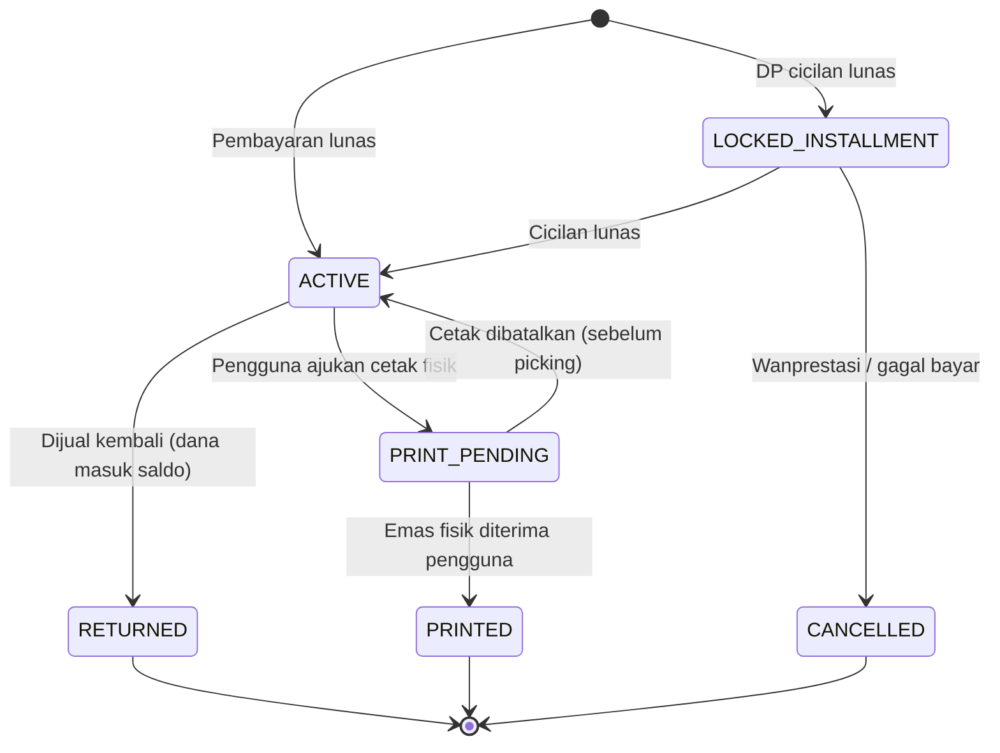
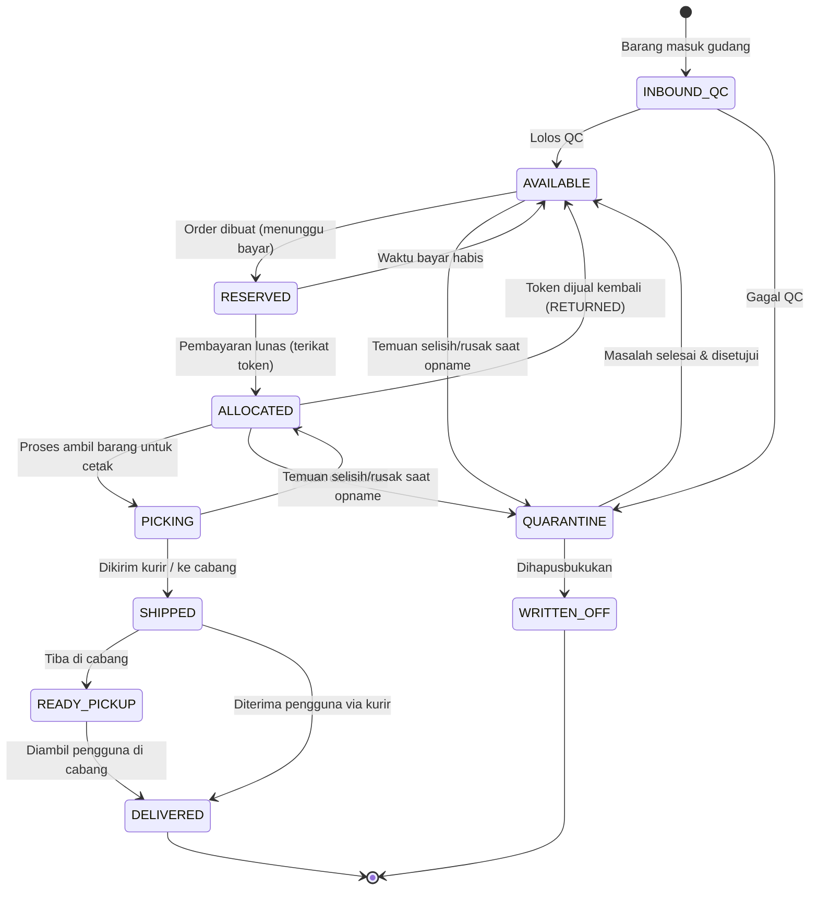

# Spesifikasi Teknis Backend REIDIG

---

## 1. Tech Stack & Struktur Proyek

Kita menggunakan arsitektur **modular monolith** agar batas antar-domain tetap bersih, mudah diuji, dan tidak membebani operasional di awal.

- **Bahasa & Framework:** Python 3.12+, FastAPI, Pydantic v2
- **Database & ORM:** PostgreSQL 16, SQlite, Alembic
- **Cache & Task Queue:** Redis, Celery

Struktur direktori utama di dalam `app/`:

```text
app/
  catalog/        # Master data SKU dan lini produk
  pricing/        # Tarik harga, riwayat harga, dan penguncian harga (quote)
  inventory/      # Manajemen keping fisik, penerimaan barang, QC, opname, karantina
  tokens/         # Siklus hidup token kepemilikan dan riwayat mutasinya
  orders/         # Transaksi jual-beli emas
  payments/       # Integrasi payment gateway (inbound) dan pencairan dana (outbound)
  wallet/         # Saldo pengguna, top-up, dan penarikan dana
  fulfillment/    # Permintaan cetak fisik, pengiriman kurir, dan ambil di cabang
  financing/      # Integrasi cicilan emas dengan mitra pembiayaan
  identity/       # Profil pengguna, KYC, PIN, dan rekening bank
  ledger/         # Pembukuan akuntansi double-entry internal
  admin/          # Role-Based Access Control (RBAC) dan log audit
  reconciliation/ # Job pencocokan stok, saldo, dan transaksi eksternal
```

### Konvensi Data (Wajib Dipatuhi)
Untuk menghindari *bug* pembulatan desimal (*floating-point error*), seluruh nilai uang dan berat disimpan sebagai bilangan bulat:
- **Rupiah:** Gunakan `integer` tanpa desimal. Saat dikirim lewat JSON, bungkus sebagai `string` (contoh: `"1450000"`) agar aman di sisi klien.
- **Berat Emas:** Gunakan `integer` dalam satuan **miligram** (`0,1 gr = 100`, `1 gr = 1000`, `1 kg = 1000000`). **Dilarang keras memakai `float`.**
- **Waktu:** Selalu simpan dan kirim dalam zona waktu **UTC** dengan format ISO 8601.

---

## 2. Konsep Inti Domain

Sebelum masuk ke alur kode, pastikan kita memiliki pemahaman yang sama tentang lima entitas utama ini:

| Konsep | Penjelasan |
|---|---|
| **SKU** | Katalog jenis produk berdasarkan berat dan lini merek. Dikelola oleh tim gudang melalui dashboard. |
| **Unit** | Keping emas fisik nyata dengan nomor seri (*serial number*) unik. Seluruh stok emas digital disimpan terpusat di gudang Jakarta (terpisah dari stok toko/website), dan baru dikirim ke cabang jika pengguna meminta cetak fisik. |
| **Token** | Bukti kepemilikan digital yang mengunci tepat **satu Unit fisik**. Token terbit saat pembelian lunas, dan mati secara permanen saat dijual kembali atau dicetak fisik (**tidak pernah dipakai ulang**). |
| **Quote** | Harga beli atau jual yang dikunci sementara (memiliki batas waktu/TTL) sebagai acuan satu transaksi. |
| **Saldo** | Dana Rupiah milik pengguna di dalam aplikasi. Nilai sebenarnya selalu dihitung dari mutasi *ledger*. |

**Format ID Token:**  
`RET-<kode SKU>-<10 karakter acak Crockford Base32><1 check digit>`  
*(Contoh: `RET-G001-7K3M9QXT4PZ`)*  
Bagian acak wajib di-generate menggunakan CSPRNG. Catatan penting: ID token ini hanya pengenal publik, **bukan kredensial akses**. Setiap aksi terhadap token tetap wajib memvalidasi kepemilikan `user_id` di sisi server.

---

## 3. Aturan Emas / Invarian Sistem (Wajib Diuji)

Sepuluh aturan di bawah ini adalah fondasi integritas sistem kita. Semuanya harus dijaga lewat *database constraint* dan diuji secara otomatis:

1. **Satu Unit, Satu Token Aktif:** Satu keping unit fisik hanya boleh memiliki maksimal satu token yang masih berjalan (dijaga ketat dengan *partial unique index* di database).
2. **Keterkaitan 1-ke-1:** Setiap token aktif wajib menunjuk ke tepat satu unit fisik yang sedang dikunci.
3. **Kemurnian Stok Tersedia:** Unit berstatus `AVAILABLE` tidak boleh terikat pada token aktif mana pun.
4. **Keseimbangan Stok & Token:** Jumlah token aktif pada suatu SKU harus selalu sama persis dengan jumlah unit berstatus `ALLOCATED`, `PICKING`, `SHIPPED`, `READY_PICKUP`, dan `QUARANTINE` (yang masih terikat token) pada SKU tersebut.
5. **Tanpa Stok Fiktif:** Sistem dilarang menjual stok kosong. Unit baru bisa berstatus `AVAILABLE` setelah fisik barang diterima gudang dan lolos QC.
6. **Imutabilitas Status Akhir:** Token yang sudah mencapai status final (`RETURNED`, `PRINTED`, `CANCELLED`) tidak bisa diubah lagi ke status apa pun.
7. **Jejak Audit Utuh:** Setiap perubahan status pada Unit maupun Token wajib menghasilkan satu baris *event log* baru yang bersifat *append-only*.
8. **Keseimbangan Akuntansi:** Setiap transaksi di *ledger* harus selalu seimbang (`Total Debit = Total Kredit`).
9. **Anti Saldo Minus:** Saldo tersedia (*available balance*) milik pengguna tidak boleh pernah bernilai negatif.
10. **Kecukupan Dana Pengguna:** Total seluruh saldo pengguna di aplikasi harus sama dengan saldo akun kewajiban (*liability*) di *ledger*, dan wajib ter-cover penuh oleh uang nyata di rekening penampungan dana pengguna.

**Penanganan Pelanggaran (Circuit Breaker):**  
Jika job rekonsiliasi menemukan pelanggaran invarian, sistem harus langsung mengirim *alert* darurat. Pelanggaran pada **poin 1–3** harus otomatis menghentikan perdagangan (*halt*) untuk SKU terkait, sedangkan pelanggaran pada **poin 9–10** harus otomatis membekukan fitur penarikan dana.

---

## 4. Siklus Status (State Machine)

### Siklus Hidup Token



### Siklus Hidup Unit Fisik



> **Catatan Penting soal Karantina:**  
> Jika sebuah unit fisik terpaksa masuk status `QUARANTINE` padahal sedang terikat ke token milik pengguna (`ALLOCATED`), sistem harus otomatis menukarnya (*swap*) dengan unit `AVAILABLE` lain dari SKU yang sama dan mencatat pertukarannya di tabel `token_unit_history`. Masalah operasional di gudang tidak boleh merugikan atau menghambat transaksi pengguna.

---

## 5. Desain Skema Database Inti

```sql
CREATE TABLE skus (
  id BIGSERIAL PRIMARY KEY,
  code TEXT UNIQUE NOT NULL,
  brand TEXT NOT NULL,
  weight_mg BIGINT NOT NULL CHECK (weight_mg > 0),
  is_active BOOLEAN NOT NULL DEFAULT TRUE
);

CREATE TABLE units (
  id BIGSERIAL PRIMARY KEY,
  sku_id BIGINT NOT NULL REFERENCES skus(id),
  serial_number TEXT NOT NULL,
  location_id BIGINT NOT NULL REFERENCES locations(id), -- gudang pusat atau cabang
  bin_location TEXT,
  status TEXT NOT NULL,
  version INT NOT NULL DEFAULT 0,
  UNIQUE (sku_id, serial_number)
);
CREATE INDEX idx_units_available ON units (sku_id, id) WHERE status = 'AVAILABLE';

CREATE TABLE tokens (
  id UUID PRIMARY KEY,
  token_code TEXT UNIQUE NOT NULL,
  user_id BIGINT NOT NULL REFERENCES users(id),
  unit_id BIGINT NOT NULL REFERENCES units(id),
  sku_id BIGINT NOT NULL REFERENCES skus(id),
  status TEXT NOT NULL,
  acquired_price BIGINT NOT NULL,
  origin_order_id BIGINT NOT NULL,
  created_at TIMESTAMPTZ NOT NULL DEFAULT now(),
  closed_at TIMESTAMPTZ
);
-- Penjaga utama Invarian #1: satu unit hanya boleh punya satu token aktif
CREATE UNIQUE INDEX uq_unit_one_open_token ON tokens (unit_id)
  WHERE status NOT IN ('RETURNED', 'PRINTED', 'CANCELLED');

CREATE TABLE token_events (
  id BIGSERIAL PRIMARY KEY,
  token_id UUID NOT NULL REFERENCES tokens(id),
  from_status TEXT,
  to_status TEXT NOT NULL,
  actor_type TEXT NOT NULL,
  actor_id TEXT,
  reason TEXT,
  prev_hash BYTEA,
  hash BYTEA NOT NULL,
  created_at TIMESTAMPTZ NOT NULL DEFAULT now()
);

-- Harga disimpan per SKU karena harga per gram tiap pecahan berbeda
CREATE TABLE sku_prices (
  id BIGSERIAL PRIMARY KEY,
  sku_id BIGINT NOT NULL REFERENCES skus(id),
  buy_price BIGINT NOT NULL CHECK (buy_price > 0),
  buyback_price BIGINT NOT NULL CHECK (buyback_price > 0),
  source TEXT NOT NULL,
  source_updated_at TIMESTAMPTZ NOT NULL,
  fetched_at TIMESTAMPTZ NOT NULL DEFAULT now(),
  CHECK (buyback_price < buy_price)
);

CREATE TABLE wallets (
  user_id BIGINT PRIMARY KEY REFERENCES users(id),
  available BIGINT NOT NULL DEFAULT 0 CHECK (available >= 0),
  held BIGINT NOT NULL DEFAULT 0 CHECK (held >= 0),
  version INT NOT NULL DEFAULT 0
);

CREATE TABLE wallet_entries (
  id BIGSERIAL PRIMARY KEY,
  user_id BIGINT NOT NULL REFERENCES wallets(user_id),
  type TEXT NOT NULL, -- SALE_CREDIT, PURCHASE_DEBIT, TOPUP, WITHDRAW_HOLD, WITHDRAW_RELEASE, WITHDRAW_SETTLE, REFUND
  amount BIGINT NOT NULL,
  reference_type TEXT NOT NULL,
  reference_id TEXT NOT NULL,
  withdrawable_at TIMESTAMPTZ,
  created_at TIMESTAMPTZ NOT NULL DEFAULT now(),
  UNIQUE (type, reference_type, reference_id)
);
```

Tabel `wallets` berfungsi sebagai *read-model* cepat untuk menampilkan saldo. Sumber kebenaran (*source of truth*) yang sesungguhnya tetap berada di `wallet_entries` dan *ledger*, yang terus dicocokkan oleh job rekonsiliasi.

### Daftar Tabel Pendukung Lainnya

| Domain | Nama Tabel |
|---|---|
| **Harga** | `quotes`, `price_source_runs` |
| **Transaksi** | `orders`, `order_items`, `payments`, `disbursements` |
| **Saldo** | `topups`, `withdrawals` |
| **Stok & Gudang** | `locations`, `unit_events`, `token_unit_history`, `inbound_batches` |
| **Stock Opname** | `stock_counts`, `stock_count_scans`, `stock_count_variances` |
| **Cetak Fisik** | `print_orders`, `print_order_items`, `shipments` |
| **Cicilan** | `financing_applications`, `financing_contracts`, `financing_events` |
| **Keuangan** | `ledger_accounts`, `ledger_entries`, `tax_rules` |
| **Infrastruktur** | `idempotency_keys`, `outbox_events`, `audit_logs` |
| **Identitas & Admin** | `users`, `kyc_records`, `bank_accounts`, `devices`, `admin_users`, `roles` |

**Keamanan Level Database:**  
Tabel `token_events`, `unit_events`, `wallet_entries`, `ledger_entries`, dan `audit_logs` bersifat mutlak *append-only*. Cabut (*revoke*) izin `UPDATE` dan `DELETE` pada tabel-tabel tersebut dari *database role* yang dipakai oleh aplikasi.

---

## 6. Alur Bisnis Utama

### 6.1 Pembelian Emas (Buy)

1. Klien memanggil `POST /v1/quotes` untuk mengunci harga sementara dengan masa berlaku (TTL) 60 detik (bisa diatur lewat konfigurasi).
2. Klien memanggil `POST /v1/orders/buy`. Di dalam **satu transaksi database**, lakukan langkah berikut:
   - Validasi apakah *quote* masih berlaku, status KYC pengguna, dan limit transaksi.
   - Kunci keping stok yang tersedia dan ubah statusnya menjadi `RESERVED` tanpa membuat antrean transaksi lain macet:
     ```sql
     SELECT id FROM units
     WHERE sku_id = :sku AND status = 'AVAILABLE'
     ORDER BY id LIMIT :qty
     FOR UPDATE SKIP LOCKED;
     ```
   - Jika jumlah baris unit yang berhasil dikunci kurang dari `qty` yang diminta, langsung batalkan (*rollback*) seluruh transaksi dan kembalikan error `409 INSUFFICIENT_STOCK`.
   - **Jika bayar pakai Saldo:** langsung potong saldo, terbitkan token `ACTIVE`, ubah unit jadi `ALLOCATED`, dan selesaikan order dalam transaksi database yang sama.
   - **Jika bayar lewat Payment Gateway:** simpan order dengan status `PENDING_PAYMENT` dan beri batas waktu bayar 15 menit.
3. Saat menerima *callback* dari iFortepay: verifikasi *signature* dan kecocokan nominal pembayaran. Jika valid, dalam satu transaksi database ubah order menjadi `PAID`, unit menjadi `ALLOCATED`, terbitkan token `ACTIVE`, dan catat jurnal *ledger*.
4. *Background worker* akan menyapu order yang lewat batas waktu bayar dan mengembalikan status unit dari `RESERVED` ke `AVAILABLE`.

> **Kasus Pembayaran Terlambat (Paid After Expiry):**  
> Jika uang baru masuk dari payment gateway setelah order dinyatakan kedaluwarsa, **jangan pernah** menerbitkan token dengan harga lama. Tandai order sebagai `PAID_AFTER_EXPIRY` dan masukkan dana pengguna ke Saldo sebagai *refund*.

### 6.2 Penjualan Emas / Buyback (Sell)

1. Klien meminta *quote* sisi `SELL` (TTL 60 detik).
2. Klien memanggil `POST /v1/orders/sell` dengan menyertakan otorisasi PIN. Dalam **satu transaksi database**:
   - Kunci baris data dengan `FOR UPDATE`, validasi kepemilikan token, pastikan statusnya `ACTIVE`, dan pastikan sudah melewati masa tahan (*holding period*).
   - Ubah status token menjadi `RETURNED`, kembalikan status unit fisik menjadi `AVAILABLE`, tambahkan dana ke saldo pengguna beserta pencatatan *ledger*, dan potong pajak (jika berlaku).

Karena dana hasil jual langsung masuk ke Saldo internal aplikasi, transaksi *buyback* bisa selesai secara instan dan atomik tanpa perlu menunggu proses transfer bank.

**Pencegahan Deadlock & Fraud:**  
- Saat mengunci baris di database, **patuhi urutan penguncian ini secara konsisten**: kunci `units` lebih dulu, baru `tokens`, lalu `wallets`.
- Terapkan **masa tahan (*holding period*)** antara waktu beli dan waktu jual (default awal 24 jam, bisa dikonfigurasi) untuk mencegah penyalahgunaan transaksi cepat dan pencucian uang.

### 6.2a Manajemen Saldo & Penarikan Dana (Withdraw)

**Penarikan Dana (`POST /v1/wallet/withdrawals` — Wajib PIN):**
1. Dalam satu transaksi database: pastikan
