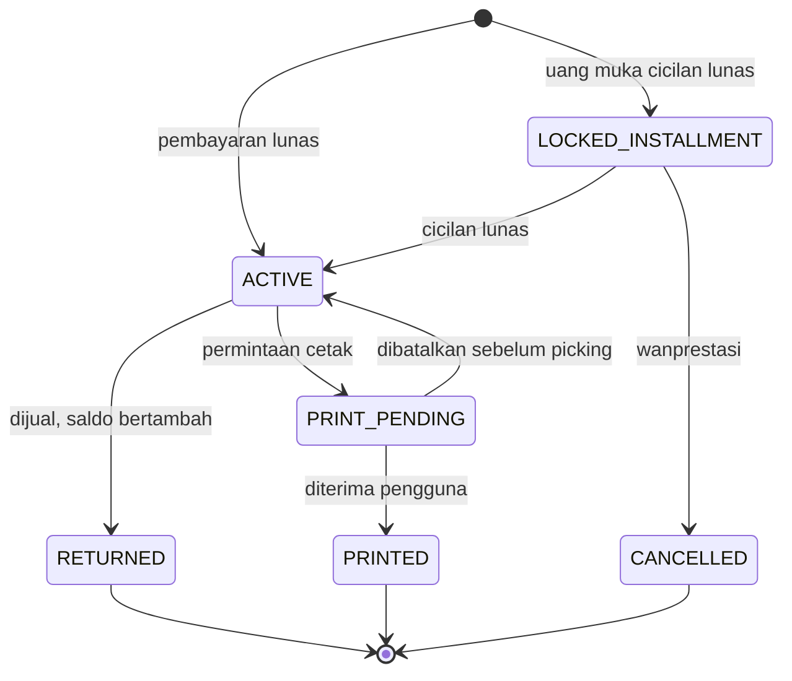
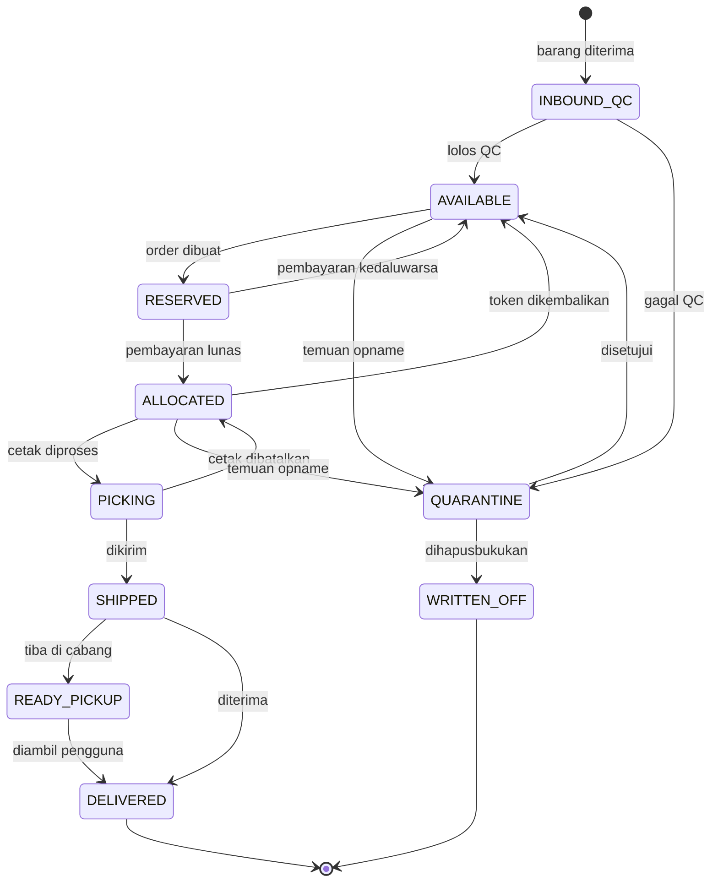

# Spesifikasi Backend REIDIG

Status: **DRAFT v3**, memuat keputusan manajemen di [01-usulan-pengembangan.md](01-usulan-pengembangan.md) §2. Sumber harga dan cicilan masih bergantung pada pertanyaan terbuka di §7 dokumen tersebut.

## 1. Stack & struktur

Python 3.12+, FastAPI, Pydantic v2, SQLAlchemy 2 + Alembic, PostgreSQL 16, Redis, Celery. Arsitektur modular monolith:

```text
app/
  catalog/      # SKU
  pricing/      # harga & quote
  inventory/    # keping, penerimaan, opname, karantina
  tokens/       # token & riwayatnya
  orders/       # beli & jual
  payments/     # payment gateway & pencairan
  wallet/       # saldo, top-up, tarik dana
  fulfillment/  # cetak emas
  financing/    # integrasi mitra cicilan
  identity/     # pengguna, KYC, PIN, rekening
  ledger/       # pembukuan double-entry
  admin/        # RBAC, audit log
  reconciliation/
```

**Konvensi nilai:**

- Rupiah: integer, tanpa desimal. Di JSON ditulis sebagai string (`"1450000"`).
- Berat: integer **miligram** (`0,1 gr = 100`, `1 kg = 1000000`). Jangan pernah memakai float.
- Waktu: UTC, format ISO 8601.

## 2. Konsep inti

| Konsep | Definisi |
|---|---|
| SKU | Jenis produk: berat dan lini produk. Dikelola tim gudang lewat dashboard |
| Unit | Satu keping fisik dengan nomor seri unik. Stok digital disimpan di gudang Jakarta, terpisah dari stok toko dan situs. Hanya pindah ke cabang saat dicetak |
| Token | Bukti kepemilikan yang mengunci satu unit. Dibuat saat dibeli, selesai saat dijual atau dicetak, **tidak pernah dipakai ulang** |
| Quote | Harga yang dikunci sementara untuk satu transaksi |
| Saldo | Dana rupiah pengguna di aplikasi, dihitung dari ledger |

Format ID token: `RET-<kode SKU>-<10 karakter Crockford Base32 acak><1 check digit>`, contoh `RET-G001-7K3M9QXT4PZ`. Bagian acak dibuat dengan CSPRNG. ID ini bukan kredensial: kepemilikan selalu diperiksa di server.

## 3. Invarian (wajib diuji)

1. Satu unit memiliki paling banyak satu token yang belum selesai (dijaga partial unique index).
2. Satu token selalu menunjuk tepat satu unit yang sedang dikunci.
3. Unit `AVAILABLE` tidak punya token yang belum selesai.
4. Jumlah token belum selesai per SKU = jumlah unit `ALLOCATED`, `PICKING`, `SHIPPED`, `READY_PICKUP`, dan `QUARANTINE` yang masih ditautkan ke token per SKU.
5. Tidak ada stok fiktif: unit baru bisa dijual setelah lolos penerimaan dan QC.
6. Token status final tidak bisa berubah lagi.
7. Setiap perubahan status unit dan token menghasilkan satu baris event yang append-only.
8. Ledger selalu seimbang: total debit = total kredit per transaksi.
9. Saldo tersedia pengguna tidak pernah negatif.
10. Total saldo seluruh pengguna = saldo akun kewajiban di ledger, dan harus tertutup oleh rekening dana pengguna.

Pelanggaran invarian saat rekonsiliasi harus memicu alert. Pelanggaran invarian 1–3 menghentikan penjualan SKU terkait, sedangkan invarian 9–10 menghentikan tarik dana.

## 4. Mesin status

### Token



### Unit



Unit yang dikarantina saat masih ditautkan ke token harus ditukar ke unit lain dengan SKU sama, lewat `token_unit_history`. Pengguna tidak boleh dirugikan oleh masalah gudang.

## 5. Model data inti

```sql
CREATE TABLE skus (
  id BIGSERIAL PRIMARY KEY,
  code TEXT UNIQUE NOT NULL,
  brand TEXT NOT NULL,
  weight_mg BIGINT NOT NULL CHECK (weight_mg > 0),
  is_active BOOLEAN NOT NULL DEFAULT TRUE
);

CREATE TABLE units (
  id BIGSERIAL PRIMARY KEY,
  sku_id BIGINT NOT NULL REFERENCES skus(id),
  serial_number TEXT NOT NULL,
  location_id BIGINT NOT NULL REFERENCES locations(id), -- gudang atau cabang
  bin_location TEXT,
  status TEXT NOT NULL,
  version INT NOT NULL DEFAULT 0,
  UNIQUE (sku_id, serial_number)
);
CREATE INDEX idx_units_available ON units (sku_id, id) WHERE status = 'AVAILABLE';

CREATE TABLE tokens (
  id UUID PRIMARY KEY,
  token_code TEXT UNIQUE NOT NULL,
  user_id BIGINT NOT NULL REFERENCES users(id),
  unit_id BIGINT NOT NULL REFERENCES units(id),
  sku_id BIGINT NOT NULL REFERENCES skus(id),
  status TEXT NOT NULL,
  acquired_price BIGINT NOT NULL,
  origin_order_id BIGINT NOT NULL,
  created_at TIMESTAMPTZ NOT NULL DEFAULT now(),
  closed_at TIMESTAMPTZ
);
-- Invarian 1: jaminan utama sistem
CREATE UNIQUE INDEX uq_unit_one_open_token ON tokens (unit_id)
  WHERE status NOT IN ('RETURNED', 'PRINTED', 'CANCELLED');

CREATE TABLE token_events (
  id BIGSERIAL PRIMARY KEY,
  token_id UUID NOT NULL REFERENCES tokens(id),
  from_status TEXT,
  to_status TEXT NOT NULL,
  actor_type TEXT NOT NULL,
  actor_id TEXT,
  reason TEXT,
  prev_hash BYTEA,
  hash BYTEA NOT NULL,
  created_at TIMESTAMPTZ NOT NULL DEFAULT now()
);

-- Harga disimpan per SKU karena harga per gram berbeda antar pecahan
CREATE TABLE sku_prices (
  id BIGSERIAL PRIMARY KEY,
  sku_id BIGINT NOT NULL REFERENCES skus(id),
  buy_price BIGINT NOT NULL CHECK (buy_price > 0),
  buyback_price BIGINT NOT NULL CHECK (buyback_price > 0),
  source TEXT NOT NULL,
  source_updated_at TIMESTAMPTZ NOT NULL,
  fetched_at TIMESTAMPTZ NOT NULL DEFAULT now(),
  CHECK (buyback_price < buy_price)
);

CREATE TABLE wallets (
  user_id BIGINT PRIMARY KEY REFERENCES users(id),
  available BIGINT NOT NULL DEFAULT 0 CHECK (available >= 0),
  held BIGINT NOT NULL DEFAULT 0 CHECK (held >= 0),
  version INT NOT NULL DEFAULT 0
);

CREATE TABLE wallet_entries (
  id BIGSERIAL PRIMARY KEY,
  user_id BIGINT NOT NULL REFERENCES wallets(user_id),
  type TEXT NOT NULL, -- SALE_CREDIT, PURCHASE_DEBIT, TOPUP, WITHDRAW_HOLD, WITHDRAW_RELEASE, WITHDRAW_SETTLE, REFUND
  amount BIGINT NOT NULL,
  reference_type TEXT NOT NULL,
  reference_id TEXT NOT NULL,
  withdrawable_at TIMESTAMPTZ,
  created_at TIMESTAMPTZ NOT NULL DEFAULT now(),
  UNIQUE (type, reference_type, reference_id)
);
```

`wallets` adalah nilai cepat baca. Sumber kebenarannya `wallet_entries` dan ledger, dan keduanya dicocokkan oleh rekonsiliasi.

Tabel lain:

| Kelompok | Tabel |
|---|---|
| Harga | `quotes`, `price_source_runs` |
| Transaksi | `orders`, `order_items`, `payments`, `disbursements` |
| Saldo | `topups`, `withdrawals` |
| Stok | `locations`, `unit_events`, `token_unit_history`, `inbound_batches` |
| Opname | `stock_counts`, `stock_count_scans`, `stock_count_variances` |
| Cetak | `print_orders`, `print_order_items`, `shipments` |
| Cicilan | `financing_applications`, `financing_contracts`, `financing_events` |
| Keuangan | `ledger_accounts`, `ledger_entries`, `tax_rules` |
| Infrastruktur | `idempotency_keys`, `outbox_events`, `audit_logs` |
| Identitas | `users`, `kyc_records`, `bank_accounts`, `devices`, `admin_users`, `roles` |

`token_events`, `unit_events`, `wallet_entries`, `ledger_entries`, dan `audit_logs` bersifat append-only: cabut hak `UPDATE` dan `DELETE` dari peran database aplikasi.

## 6. Alur utama

### 6.1 Beli

1. `POST /v1/quotes` mengunci harga, TTL 60 detik (bisa dikonfigurasi).
2. `POST /v1/orders/buy` dalam satu transaksi:
   - validasi quote, status KYC, dan limit;
   - kunci stok, lalu ubah unit menjadi `RESERVED`:
     ```sql
     SELECT id FROM units
     WHERE sku_id = :sku AND status = 'AVAILABLE'
     ORDER BY id LIMIT :qty
     FOR UPDATE SKIP LOCKED;
     ```
   - kalau unit yang didapat kurang dari `qty`, batalkan seluruh order dengan `409 INSUFFICIENT_STOCK`;
   - **bayar dengan saldo:** kurangi saldo, buat token, dan selesaikan order dalam transaksi yang sama;
   - **bayar lewat gateway:** buat order `PENDING_PAYMENT` dengan batas bayar 15 menit.
3. Callback iFortepay: verifikasi tanda tangan dan jumlah, lalu dalam satu transaksi order menjadi `PAID`, unit menjadi `ALLOCATED`, token dibuat `ACTIVE`, dan ledger dicatat.
4. Worker melepas order yang kedaluwarsa dan mengembalikan unit ke `AVAILABLE`.

**Pembayaran terlambat:** kalau uang masuk setelah order kedaluwarsa, jangan otomatis membuat token dengan harga lama. Tandai `PAID_AFTER_EXPIRY` dan kembalikan dananya ke saldo.

### 6.2 Jual

1. Quote sisi `SELL`, TTL 60 detik.
2. `POST /v1/orders/sell` memerlukan otorisasi PIN. Dalam **satu transaksi**: kunci token dengan `FOR UPDATE`, validasi pemilik, status `ACTIVE`, dan masa tahan; token menjadi `RETURNED`; unit menjadi `AVAILABLE`; saldo dan ledger bertambah; pajak dicatat bila ada.

Karena dana masuk saldo, penjualan selesai tanpa bergantung pada bank. Tidak ada status menggantung antara token dan pencairan. Urutan kunci baris wajib konsisten (unit, lalu token, lalu saldo) supaya tidak terjadi deadlock.

**Masa tahan** antara beli dan jual (usulan awal 24 jam, bisa dikonfigurasi) mengurangi risiko fraud dan pencucian uang.

### 6.2a Saldo & redeem uang

**Tarik dana:** `POST /v1/wallet/withdrawals` memerlukan PIN.

1. Dalam satu transaksi: validasi rekening atas nama pengguna, batas harian, dan `withdrawable_at`; pindahkan nominal dari `available` ke `held`; buat `withdrawal` dan `disbursement`.
2. Berhasil: kurangi `held` dan catat ledger.
3. Gagal final: kembalikan `held` ke `available`.
4. Status tidak jelas (timeout dari vendor): **jangan melepas dana**. Cek status ke vendor, lalu masukkan ke antrean Finance kalau belum jelas.

**Top-up:** `POST /v1/wallet/topups`, di balik saklar `WALLET_TOPUP_ENABLED`, bawaan nonaktif sampai cakupan izin terkonfirmasi. Dana top-up diberi `withdrawable_at` supaya saldo tidak dipakai sebagai jalur masuk-keluar uang tanpa transaksi emas.

**Sumber saldo lain:** hasil jual dan refund. Batas saldo maksimum dan batas transaksi dibuat konfigurasi per tingkat KYC.

### 6.3 Cetak emas

Gudang hanya ada di Jakarta. Satu pesanan bisa berisi beberapa token milik pengguna yang sama.

1. `GET /v1/print-orders/options?token_codes=` mengembalikan pilihan yang tersedia, biaya, serta estimasi waktu per cabang. Cabang terdekat dihitung dari lokasi atau alamat pengguna.
2. `POST /v1/print-orders` berisi token, metode, dan alamat atau cabang tujuan. Token menjadi `PRINT_PENDING`.
3. Gudang melakukan picking dengan **memindai setiap seri**, yang harus cocok dengan unit milik token. Unit menjadi `PICKING`.

**Dikirim dengan JNE (`SHIP`):**

4. Gudang mencatat resi. Unit menjadi `SHIPPED`.
5. Saat diterima pengguna, unit menjadi `DELIVERED` dan token menjadi `PRINTED`.

**Diambil di cabang (`PICKUP`):**

- **Syarat:** total berat token dalam pesanan minimal `PRINT_PICKUP_MIN_WEIGHT_MG` (saat ini 2000 mg). Kalau kurang, tolak dengan `PICKUP_MIN_WEIGHT_NOT_MET`. Nilainya berupa konfigurasi, bukan ditulis mati di kode.

4. Gudang mengirim keping ke cabang dan mencatat nomor pengiriman. Unit menjadi `SHIPPED`, dan pengguna melihat status "dalam perjalanan ke cabang" dengan estimasi tiba.
5. Petugas cabang memindai setiap seri saat tiba. Unit pindah lokasi ke cabang dan menjadi `READY_PICKUP`.
6. Setelah semua tiba, sistem membuat kode pengambilan, memberi tahu pengguna, dan menetapkan batas waktu pengambilan (usulan awal 14 hari).
7. Petugas memeriksa KTP dan kode pengambilan. Unit menjadi `DELIVERED` dan token menjadi `PRINTED`.

Selama `READY_PICKUP`, keping tetap terkunci token dan disimpan terpisah dari stok toko. Melewati batas waktu memicu pengingat dan antrean Operasional. Kebijakan selanjutnya masih perlu diputuskan.

Pembatalan hanya bisa sebelum picking.

**Paket hilang atau gagal kirim:** token tetap `PRINT_PENDING` dan kasus masuk antrean Operasional. Paket yang kembali diperiksa ulang lewat QC. Paket yang hilang diklaim ke asuransi, dan pengguna dikirimi unit pengganti dengan SKU sama.

### 6.4 Cicil emas lewat mitra

Mitra menilai kredit, membuat kontrak, dan menagih. Backend mengelola kunci unit dan token. Detail menyesuaikan API mitra, yang belum dipilih.

1. `POST /v1/financing/applications`: harga dikunci, unit menjadi `RESERVED` selama batas waktu yang disepakati dengan mitra, dan pengajuan dikirim ke mitra.
2. Ditolak atau kedaluwarsa: unit kembali `AVAILABLE`.
3. Disetujui dan uang muka lunas: unit `ALLOCATED`, token `LOCKED_INSTALLMENT`, dan piutang kepada mitra dicatat di ledger. Token tidak bisa dijual atau dicetak.
4. Webhook lunas dari mitra: token menjadi `ACTIVE`.
5. Webhook wanprestasi: token `CANCELLED` dan unit `AVAILABLE`, atau mengikuti skema kontrak. Instruksi yang berdampak pada stok masuk antrean persetujuan.

Jadwal angsuran ditampilkan dari data mitra. Rekonsiliasi harian mencocokkan kontrak aktif mitra dengan token `LOCKED_INSTALLMENT`.

## 7. Kontrak API

Header wajib untuk semua operasi tulis: `Authorization: Bearer <jwt>` dan `Idempotency-Key: <uuid>`. Permintaan ulang dengan kunci yang sama mengembalikan hasil yang sama. Kunci yang sama dengan isi berbeda mengembalikan `422 IDEMPOTENCY_KEY_REUSED`.

### Aplikasi mobile

| Metode | Endpoint | Fungsi |
|---|---|---|
| POST | `/v1/auth/register/email`, `/v1/auth/register/email/verify` | Daftar, OTP email 6 digit |
| POST | `/v1/auth/google` | Masuk atau daftar dengan Google |
| PUT | `/v1/me/profile` | Nama sesuai KTP, tanggal lahir (minimal 18 tahun), kata sandi |
| POST | `/v1/auth/login`, `/v1/auth/refresh`, `/v1/auth/logout` | Sesi |
| POST | `/v1/auth/password/forgot`, `/v1/auth/password/reset` | Reset kata sandi |
| POST | `/v1/phone/otp/request`, `/v1/phone/otp/verify` | OTP HP, kanal `WHATSAPP` atau `SMS` |
| POST | `/v1/auth/pin`, `/v1/auth/pin/verify` | Mengatur PIN 6 digit (tolak pola lemah) dan memverifikasi |
| POST | `/v1/consents` | Persetujuan syarat dan data dengan versi dokumen; penawaran bersifat opsional |
| POST/GET | `/v1/kyc/sessions`, `/v1/kyc/status` | Sesi vendor KYC dan statusnya |
| POST | `/v1/kyc/review` | Konfirmasi data hasil pindai; nama dan tanggal lahir harus cocok dengan profil |
| GET/POST | `/v1/bank-accounts` | Rekening terverifikasi |
| GET | `/v1/wallet`, `/v1/wallet/entries` | Saldo dan mutasi |
| POST/GET | `/v1/wallet/withdrawals`, `/v1/wallet/topups` | Tarik dana dan top-up |
| GET | `/v1/skus` | Katalog beserta harga beli, harga buyback, dan ketersediaan |
| GET | `/v1/prices/current`, `/v1/prices/history` | Harga |
| POST | `/v1/quotes` | Mengunci harga |
| POST | `/v1/orders/buy`, `/v1/orders/sell` | Beli dan jual |
| GET | `/v1/orders`, `/v1/orders/{id}` | Riwayat |
| GET | `/v1/portfolio`, `/v1/tokens/{code}` | Token dan riwayatnya |
| GET | `/v1/print-orders/options` | Pilihan JNE atau cabang, biaya, dan estimasi waktu |
| POST/GET | `/v1/print-orders`, `/v1/print-orders/{id}` | Cetak emas dan status terkini |
| POST | `/v1/print-orders/{id}/cancel` | Batal cetak |
| POST | `/v1/financing/simulate`, `/v1/financing/applications` | Simulasi dan pengajuan |
| GET | `/v1/financing/contracts`, `/v1/financing/contracts/{id}` | Kontrak dan jadwal dari mitra |

### Webhook

`POST /webhooks/payments/ifortepay`, `/webhooks/disbursements/ifortepay`, `/webhooks/shipments/{provider}`, `/webhooks/financing/{provider}`. Wajib verifikasi tanda tangan, idempoten, dan aman menerima pesan yang datang tidak berurutan.

### Dashboard (`/admin/v1`)

| Modul | Endpoint |
|---|---|
| SKU | `GET/POST /skus`, `PATCH /skus/{id}` |
| Stok | `GET /units`, `GET /units/{serial}`, `POST /inbound-batches`, `POST /inbound-batches/{id}/qc` |
| Karantina | `POST /units/{id}/quarantine`, `POST /tokens/{id}/swap-unit` |
| Opname | `POST /stock-counts`, `POST /stock-counts/{id}/scans`, `POST /stock-counts/{id}/submit`, `GET /stock-counts/{id}/variances`, `POST /stock-counts/{id}/approve` |
| Pemenuhan | `GET /print-orders`, `POST /print-orders/{id}/pick`, `POST /print-orders/{id}/ship`, `POST /print-orders/{id}/receive-at-branch`, `POST /print-orders/{id}/complete-pickup` |
| Harga | `GET /prices/status`, `POST /trading/halt`, `POST /trading/resume` |
| Keuangan | `GET /withdrawals`, `POST /disbursements/{id}/retry`, `GET /wallets/{user_id}/entries`, `POST /wallet-adjustments`, `GET /reconciliation/reports` |
| Cicilan | `GET /financing/contracts`, `GET /financing/mismatches` |
| KYC/AML | `GET /kyc/queue`, `POST /kyc/{id}/decision`, `GET /aml/alerts` |
| Audit | `GET /audit-logs`, `GET /tokens/{code}/trail` |

### Contoh

```http
POST /v1/quotes
{ "side": "BUY", "sku_code": "G001", "quantity": 2 }

201 Created
{
  "quote_id": "qt_01J...",
  "unit_price": "2513500",
  "subtotal": "5027000",
  "tax": "0",
  "fee": "0",
  "total": "5027000",
  "buyback_value_now": "4620000",
  "expires_at": "2026-11-03T10:01:00Z"
}
```

```http
POST /v1/orders/buy
{ "quote_id": "qt_01J...", "payment_method": "QRIS" }

201 Created
{
  "order_id": "ord_01J...",
  "status": "PENDING_PAYMENT",
  "pay_before": "2026-11-03T10:15:00Z",
  "payment": { "method": "QRIS", "qr_string": "..." }
}
```

```json
{
  "error": {
    "code": "INSUFFICIENT_STOCK",
    "message": "Stok SKU tidak mencukupi.",
    "request_id": "req_01J..."
  }
}
```

Kode error minimum: `QUOTE_EXPIRED`, `INSUFFICIENT_STOCK`, `KYC_REQUIRED`, `LIMIT_EXCEEDED`, `TOKEN_NOT_OWNED`, `TOKEN_LOCKED`, `HOLDING_PERIOD_ACTIVE`, `TRADING_HALTED`, `INVALID_PIN`, `PIN_LOCKED`, `INSUFFICIENT_BALANCE`, `FUNDS_NOT_WITHDRAWABLE`, `WITHDRAWAL_LIMIT_EXCEEDED`, `TOPUP_DISABLED`, `PICKUP_MIN_WEIGHT_NOT_MET`, `INVALID_PICKUP_CODE`.

## 8. Stock opname

1. Supervisor membuat sesi: gudang atau cabang, cakupan SKU atau lokasi, jenis (penuh atau sampling). Di cabang, cakupannya hanya keping pesanan cetak yang menunggu diambil.
2. Petugas memindai seri secara **buta**: jumlah yang diharapkan sistem tidak ditampilkan. Selama sesi berjalan, API juga tidak boleh memberi petugas daftar keping di lokasi itu.
3. Transaksi tetap berjalan. Perpindahan unit selama sesi dicatat, supaya tidak terbaca sebagai selisih palsu.
4. Saat dikirim, sistem menghitung selisih: `MISSING`, `UNEXPECTED`, `WRONG_LOCATION`, `SKU_MISMATCH`.
5. Selisih dihitung ulang oleh **orang berbeda**.
6. Supervisor menyetujui, dan penyesuaian besar memerlukan Finance. Stok hanya berubah lewat penyesuaian yang disetujui.
7. Unit `MISSING` masuk karantina. Kalau bertoken, token dipindah ke unit lain dan insiden dicatat.

Aplikasi pemindaian di dashboard harus mendukung barcode/QR lewat scanner USB/Bluetooth dan tetap bisa dipakai di tablet.

## 9. Pekerjaan latar

| Pekerjaan | Frekuensi |
|---|---|
| Ambil harga; hentikan transaksi otomatis kalau harga basi atau melonjak tak wajar | Sesuai jadwal pembaruan situs |
| Melepas order dan pengajuan cicilan yang kedaluwarsa | Tiap 1 menit |
| Mengecek status pembayaran dan pencairan yang menggantung | Tiap 5 menit |
| Rekonsiliasi saldo terhadap ledger dan rekening dana pengguna | Harian, dan ledger tiap jam |
| Rekonsiliasi kontrak dengan mitra pembiayaan | Harian |
| Memproses outbox (notifikasi, event) | Terus-menerus |
| Rekonsiliasi invarian token ↔ unit | Tiap jam |
| Rekonsiliasi dengan laporan payment gateway dan bank | Harian |
| Verifikasi hash chain | Harian |

## 10. Keamanan

- **Pengguna:** email + kata sandi atau Google, OTP email dan HP dengan batas percobaan serta jeda kirim ulang 30 detik, PIN (kata sandi dan PIN di-hash Argon2id, kunci setelah gagal berulang), biometrik lewat Android Keystore, device binding, Play Integrity, certificate pinning.
- **Operasi sensitif** seperti jual, cetak, tarik dana, dan ganti rekening memerlukan verifikasi ulang PIN. Tarik dana ke rekening baru ditahan untuk sementara.
- **Admin:** SSO/MFA wajib, batas IP atau VPN, maker-checker untuk penyesuaian stok, penyesuaian saldo, penghentian atau pembukaan kembali transaksi, dan penukaran unit.
- **Cabang:** petugas hanya bisa memproses pesanan cetak untuk cabangnya sendiri.
- **Data:** enkripsi KTP dan data sensitif di level kolom; dokumen KYC di object storage terenkripsi dengan URL berbatas waktu; jangan mencatat PII di log.
- **Lainnya:** rate limiting; secret manager; backup dengan PITR dan uji pemulihan berkala; audit terhadap setiap akses data KYC.

### Peran dashboard

| Peran | Stok | Opname | Harga | Keuangan | KYC | Audit |
|---|---|---|---|---|---|---|
| WAREHOUSE_STAFF | Tulis terbatas | Pindai | – | – | – | – |
| WAREHOUSE_SUPERVISOR | Tulis | Setujui | – | – | – | Baca |
| TREASURY | Baca | – | Tulis | Baca | – | – |
| FINANCE | Baca | Baca | Baca | Tulis | – | Baca |
| COMPLIANCE | – | – | – | Baca | Tulis | Baca |
| CS | Baca token | – | Baca | Baca | Baca terbatas | – |
| AUDITOR | Baca | Baca | Baca | Baca | Baca | Baca |

## 11. Integrasi

Bungkus setiap layanan dengan antarmuka internal supaya vendor bisa diganti tanpa mengubah logika bisnis.

### Daftar API dan layanan eksternal

Kolom Tahap mengikuti usulan pengembangan.

#### Identitas dan KYC

| Kebutuhan | API atau layanan | Status | Tahap | Antarmuka |
|---|---|---|---|---|
| Verifikasi NIK, nama, tanggal lahir | **Dukcapil**, lewat vendor eKYC atau kerja sama langsung | Perlu dipilih | MVP | `KycProvider` |
| Pencocokan wajah dengan data kependudukan | **Face recognition Dukcapil**, lewat jalur yang sama | Perlu dipilih | MVP | `KycProvider` |
| Pembacaan foto KTP (OCR) | API vendor eKYC | Perlu dipilih | MVP | `KycProvider` |
| Liveness (memastikan wajah asli) | SDK vendor eKYC untuk Android, lalu iOS | Perlu dipilih | MVP | `KycProvider` |
| Masuk dengan Google | **Google Identity**; backend memverifikasi ID token | Sudah ditentukan | MVP | `AuthProvider` |

Akses Dukcapil berupa hak verifikasi, bukan penyerahan data, dan memerlukan [kerja sama dengan Ditjen Dukcapil](https://m.jpnn.com/news/dirjen-dukcapil-mitra-kerja-sama-hanya-diberi-akses-verifikasi-data). **Rekomendasi: pakai vendor eKYC yang sudah punya akses**, karena satu vendor bisa sekaligus memberi OCR, liveness, dan verifikasi Dukcapil. Kerja sama langsung baru dipertimbangkan kalau volume sudah besar. Tarif verifikasi perlu dicek ke vendor; [PP 10/2023](https://teknologi.bisnis.com/read/20230401/101/1642827/pp-102023-resmi-berlaku-berikut-tarif-untuk-akses-data-dukcapil) dilaporkan menetapkan Rp 1.000 per NIK dan Rp 3.000 per biometrik wajah.

#### Komunikasi

| Kebutuhan | API atau layanan | Status | Tahap | Antarmuka |
|---|---|---|---|---|
| OTP nomor HP lewat WhatsApp | **WhatsApp Business Platform (Cloud API)**, langsung ke Meta atau lewat BSP | Perlu dipilih | MVP | `OtpProvider` |
| OTP nomor HP lewat SMS | SMS gateway; juga cadangan kalau WhatsApp gagal | Perlu dipilih | MVP | `OtpProvider` |
| OTP email, reset kata sandi, bukti transaksi | Layanan email transaksional | Perlu dipilih | MVP | `EmailProvider` |
| Notifikasi aplikasi | **Firebase Cloud Messaging**; iOS lewat APNs | Sudah ditentukan | MVP | `PushProvider` |
| Status terkirim WhatsApp | Webhook WhatsApp ke `POST /webhooks/whatsapp` | Perlu dipilih | MVP | `OtpProvider` |

WhatsApp memerlukan akun WhatsApp Business terverifikasi dan template autentikasi yang disetujui Meta, jadi urus sejak awal. Hitung biaya per pesan dari [halaman harga resmi Meta](https://developers.facebook.com/documentation/business-messaging/whatsapp/pricing/authentication-international-rates).

#### Pembayaran dan dana

| Kebutuhan | API atau layanan | Status | Tahap | Antarmuka |
|---|---|---|---|---|
| Bayar QRIS | **iFortepay SNAP QRIS** | Sudah ditentukan | MVP | `PaymentProvider` |
| Bayar Virtual Account | **iFortepay SNAP VA** | Sudah ditentukan | MVP | `PaymentProvider` |
| Validasi nama rekening | **iFortepay Account Inquiry** | Sudah ditentukan | MVP | `DisbursementProvider` |
| Tarik dana | **iFortepay Transfer Interbank** | Sudah ditentukan | MVP | `DisbursementProvider` |
| Rekonsiliasi | iFortepay Query Payment, Inquiry VA, Transaction History | Sudah ditentukan | MVP | Keduanya |
| Top-up saldo | iFortepay QRIS atau VA, nonaktif sampai izin terkonfirmasi | Perlu dipilih | Menyusul | `PaymentProvider` |

Detail ada di bagian [iFortepay](#ifortepay).

#### Operasional

| Kebutuhan | API atau layanan | Status | Tahap | Antarmuka |
|---|---|---|---|---|
| Harga emas | **Endpoint harga internal emasmurniasli.co.id**, perlu dibuat tim situs | Perlu dipilih | MVP | `PriceFeed` |
| Ongkir, pembuatan resi, pelacakan | **JNE API** | Perlu dipilih | Cetak Emas | `ShippingProvider` |
| Cicilan | **API mitra pembiayaan**: pengajuan, status, callback lunas dan wanprestasi | Perlu dipilih | Cicil Emas | `FinancingProvider` |
| Penyimpanan foto KYC dan dokumen | Object storage terenkripsi, kompatibel S3 | Perlu dipilih | MVP | `DocumentStorage` |

- **JNE:** dokumentasi resmi tidak ditemukan secara publik, dan [kredensial diberikan oleh tim JNE](https://support.unicommerce.com/index.php/knowledge-base/integration-with-jne-express-indonesia/). Hubungi JNE untuk akses API. **Pastikan juga JNE menerima dan mengasuransikan logam mulia sampai nilai keping terbesar**; syarat resminya belum ditemukan. Sebagai pembanding, Paxel punya [layanan khusus barang bernilai tinggi](https://paxel.co/en/news-and-promos/peek-how-to-safely-send-gold-or-precious-metals-using-paxel).
- **Gudang ke cabang:** diasumsikan pengiriman internal, sehingga tanpa API dan nomor pengirimannya dicatat manual.
- **Cabang terdekat:** cukup hitung jarak dari koordinat cabang di backend. API peta tidak diperlukan di tahap awal.

#### Keamanan dan platform

| Kebutuhan | API atau layanan | Status | Tahap | Antarmuka |
|---|---|---|---|---|
| Keaslian aplikasi Android | **Google Play Integrity API** | Sudah ditentukan | MVP | `DeviceAttestation` |
| Keaslian aplikasi iOS | **Apple App Attest** | Sudah ditentukan | iOS | `DeviceAttestation` |
| Penyimpanan rahasia | Secret manager | Perlu dipilih | MVP | – |
| Pemantauan kesalahan dan performa | OpenTelemetry dan layanan pemantauan | Perlu dipilih | MVP | – |

#### Kepatuhan (konfirmasi ke tim legal)

| Kebutuhan | API atau layanan | Status | Tahap | Antarmuka |
|---|---|---|---|---|
| Penyaringan DTTOT dan DPPSPM | Basis data internal dari daftar resmi, atau API vendor | Perlu dipilih | MVP | `ScreeningProvider` |
| Laporan transaksi ke PPATK | **goAML**, bisa dimulai dengan ekspor untuk unggahan manual | Perlu dipilih | MVP | `RegulatoryReporting` |
| Laporan ke regulator emas digital | Format dan caranya perlu dikonfirmasi | Perlu dipilih | MVP | `RegulatoryReporting` |
| Tanda tangan elektronik dan e-meterai | Vendor PSrE, kalau kontrak mewajibkannya | Perlu dipilih | Cicil Emas | `SigningProvider` |

Kewajiban pastinya bergantung pada izin yang dimiliki. Aturan untuk [pedagang aset keuangan digital](https://ojk.go.id/id/regulasi/Documents/Pages/SEOJK-16-SEOJK07-2025-Penerapan-Program-APU-PPT-dan-Pencegahan-Pendanaan-Proliferasi-Senjata-Pemusnah-Massal-Pedagang-AKD/SEOJK%2016-SEOJK07-2025%20Penerapan%20Program%20APU%20PPT%20dan%20Pencegahan%20Pendanaan%20Proliferasi%20Senjata%20Pemusnah%20Massal%20bagi%20Pedagang%20AKD.pdf) bisa menjadi gambaran, dan [pedagang emas digital dilaporkan wajib menyetor laporan keuangan](https://news.ddtc.co.id/berita/nasional/1800211/pedagang-fisik-emas-digital-wajib-setor-laporan-keuangan-ke-pemerintah), tetapi aturan APU PPT khusus emas digital belum ditemukan.

#### Urutan pengurusan akses

Sebagian akses butuh kontrak dan waktu tunggu, jadi mulai lebih awal:

1. **iFortepay:** kredensial stage, lalu daftarkan URL callback.
2. **Vendor eKYC:** evaluasi, kontrak, dan akses sandbox.
3. **WhatsApp:** verifikasi bisnis dan persetujuan template.
4. **Tim situs:** endpoint harga internal.
5. **Tim legal:** kewajiban pelaporan dan penyaringan.
6. **JNE dan mitra pembiayaan:** menjelang tahap masing-masing.

Lingkungan pengembangan wajib memakai implementasi tiruan untuk setiap antarmuka di atas, supaya pengujian tidak mengirim pesan atau uang sungguhan.

### iFortepay

Sumber: [dokumentasi resmi](https://developer.ifortepay.id/). Gunakan API **SNAP**. Kredensial didapat dari tim integrasi iFortepay. **Client secret hanya ada di backend**; aplikasi tidak pernah memanggil iFortepay langsung, dan hanya menampilkan QR atau nomor VA dari backend.

| Produk | Stage | Production |
|---|---|---|
| Pembayaran | `https://api-stage.ifortepay.id` | `https://api.ifortepay.id` |
| Disbursement | `https://api-stage.senmo.id` | `https://api.senmo.id` |

| Kebutuhan REIDIG | API iFortepay | Catatan |
|---|---|---|
| Bayar QRIS | Generate QR, Query Payment, Cancel Payment | QR Dynamic, sekali pakai dengan nominal tetap |
| Bayar VA | Create VA, Inquiry VA, Delete VA | Tipe `C` (Single Close Amount), nominal tetap |
| Status bayar | Callback Payment Notify | Sumber utama. Query dan Inquiry sebagai cadangan saat callback tidak datang |
| Order kedaluwarsa | Cancel Payment, Delete VA | Batalkan di iFortepay saat melepas keping, supaya mengurangi pembayaran terlambat |
| Validasi nama rekening | Account Inquiry | Cocokkan dengan nama KYC sebelum rekening disimpan |
| Tarik dana | Transfer Interbank | Wajib signature simetris dan access token B2B |
| Status tarik dana tidak jelas | Transaction History Detail | Cek dulu sebelum mengirim ulang |
| Saldo disbursement | Balance Inquiry | Pantau supaya penarikan tidak gagal karena saldo habis |

**Aturan implementasi:**

- **Verifikasi callback:** `X-SIGNATURE` = Base64(HMAC-SHA512(clientSecret, stringToSign)), dengan `stringToSign = notifyUrl + ":" + X-VERSION + ":" + lowercase(hex(SHA-256(minifiedBody))) + ":" + X-TIMESTAMP`. Tolak kalau tidak cocok, dan cocokkan nominal dengan order.
- **Balasan callback:** kembalikan HTTP 200 setelah data tersimpan. Proses harus idempoten karena callback bisa datang lebih dari sekali.
- **Permintaan keluar:** `X-EXTERNAL-ID` harus unik dalam satu hari. Simpan bersama order agar percobaan ulang tidak membuat transaksi ganda.
- **Pengujian:** gunakan lingkungan stage dan Payment Simulator iFortepay.

Rincian kontrak endpoint, batas nominal, dan biaya perlu diverifikasi langsung ke dokumentasi dan tim iFortepay saat implementasi. Kartu kredit tidak termasuk tahap ini dan memerlukan koordinasi dengan tim iFortepay.

### Sumber harga

Usulan kontrak endpoint internal dari tim situs:

```http
GET /internal/prices/current
X-Signature: <HMAC isi respons>

{
  "updated_at": "2026-11-03T02:13:00Z",
  "buyback_per_gram": "2310000",
  "items": [
    { "product": "LM Raja Emas", "weight_mg": 1000, "buy_price": "2513500" }
  ]
}
```

Aturan, apa pun cara pengambilannya:

- Validasi setiap harga: harus positif, harga beli lebih tinggi dari buyback, dan perubahan dari harga sebelumnya tidak melebihi batas yang dikonfigurasi.
- Harga yang tidak lolos validasi **tidak disimpan sebagai harga aktif** dan memicu alert.
- Harga lebih tua dari `PRICE_MAX_AGE` membuat transaksi berhenti dengan `TRADING_HALTED`.
- SKU tanpa pemetaan harga tidak bisa diperdagangkan.
- Kalau terpaksa membaca HTML, gunakan sebagai solusi sementara: wajib ada dua kali pembacaan yang konsisten dan persetujuan manusia untuk perubahan besar.

Harga buyback per SKU saat ini diasumsikan `berat × buyback_per_gram`, sesuai simulator situs. Ini perlu dikonfirmasi, karena situs menyebutnya estimasi sebelum pemeriksaan fisik, sedangkan penjualan token tidak memerlukan pemeriksaan fisik.

Tarif pajak dan biaya disimpan di `tax_rules` dengan masa berlaku, dan nilainya dicatat ke setiap order agar laporan lama tidak berubah saat tarif baru berlaku.

## 12. Kebutuhan non-fungsional (usulan awal)

- API p95 < 300 ms di luar panggilan vendor; ketersediaan 99,9%.
- Ketersediaan harga dan katalog di-cache; penempatan stok dan pembuatan token selalu lewat database utama.
- Log terstruktur dengan `request_id`, metrik, dan tracing (OpenTelemetry).
- Alert untuk: pelanggaran invarian, feed harga basi, pencairan gagal, antrean webhook menumpuk.

## 13. Kriteria penerimaan

Wajib lolos otomatis di CI:

1. **Race pembelian:** 500 pembeli paralel berebut 100 unit SKU yang sama menghasilkan tepat 100 token dan tanpa unit ganda.
2. **Webhook ganda:** webhook yang sama dikirim 5 kali hanya membuat satu set token.
3. **Double-spend:** jual dan cetak token yang sama secara bersamaan menghasilkan tepat satu yang berhasil.
4. **Kunci harga:** quote kedaluwarsa ditolak.
5. **Tarik dana:** permintaan paralel tidak bisa melebihi saldo. Gagal final mengembalikan dana, sedangkan timeout tidak melepas dana.
6. **Siklus ulang:** unit yang dijual lalu dibeli pengguna lain mendapat token baru, dan riwayat token lama tetap utuh.
7. **Cicilan:** token `LOCKED_INSTALLMENT` tidak bisa dijual atau dicetak.
8. **Opname:** selisih tidak mengubah stok sampai disetujui.
9. **Hak akses:** setiap endpoint admin ditolak untuk peran yang tidak berwenang.
10. **Rekonsiliasi:** data yang dirusak sengaja di test terdeteksi.
11. **Harga:** harga basi atau tidak wajar menghentikan transaksi, dan harga lama tidak dipakai.
12. **Atomik jual:** kegagalan di tengah penjualan tidak mengubah token, unit, maupun saldo.
13. **Mitra:** webhook lunas ganda hanya mengaktifkan token sekali, dan token tidak bisa aktif tanpa webhook yang valid.
14. **Ambil di cabang:** pesanan di bawah 2 gr ditolak, 2 × 1 gr diterima, dan keping baru bisa diambil setelah semua seri dipindai tiba di cabang serta kode pengambilan benar.

Gunakan PostgreSQL asli di pengujian (misalnya Testcontainers), bukan SQLite, karena pengujian ini bergantung pada perilaku lock. Tambahkan pengujian berbasis properti untuk mesin status.

## 14. Keluaran yang diharapkan dari tim backend

1. Spesifikasi OpenAPI, diselesaikan lebih dulu agar frontend bisa mulai dengan mock.
2. Migrasi skema dan seed SKU.
3. Sandbox yang terhubung ke vendor mode uji.
4. Runbook: rekonsiliasi gagal, pencairan menggantung, penghentian transaksi darurat.
