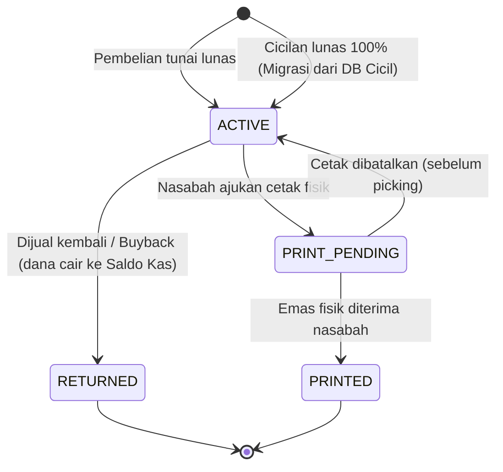
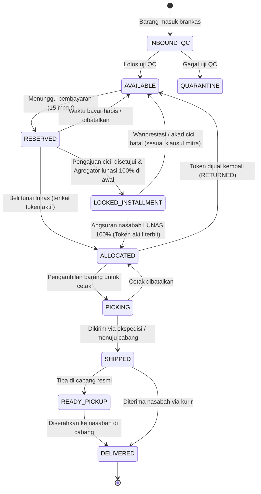
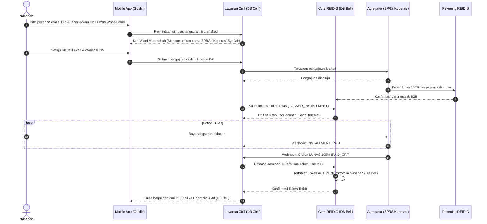

# Spesifikasi Teknis & Panduan Backend REIDIG (Raja Emas Indonesia Digital)

Dokumen ini merupakan acuan arsitektur, aturan domain, skema database, panduan operasional server, serta kontrak API antara backend (`reidig-sys`), aplikasi mobile nasabah (`android` — **Goldin Prototype v1**), dan portal operasional (`dashboard`).

---

## 1. Tech Stack & Arsitektur Sistem

REIDIG menerapkan **Two-Tier Decoupled Architecture (Modular Core + Dedicated Installment Subsystem)** untuk menjaga integritas kepemilikan emas tunai tetap terisolasi dari proses penagihan dan pembiayaan cicilan:

1. **Core REIDIG Service ("Database Beli" — `reidig_core`)**:
   - Mengelola master data SKU, inventori brankas emas fisik (Jakarta & cabang), penerbitan token kepemilikan sah nasabah, dompet rupiah, transaksi beli/jual tunai (*buyback*), dan pemenuhan cetak fisik.
   - **Database Produksi:** PostgreSQL 16 (`reidig_core`).
2. **Installment Service ("Database Cicil" — `reidig_installment`)**:
   - Mengelola pengajuan pembiayaan cicilan nasabah, dokumen akad syariah (*Murabahah*), integrasi agregator pembiayaan pihak ketiga (BPRS / Koperasi Syariah), jadwal angsuran bulanan, dan penagihan berkala.
   - **Database Produksi:** PostgreSQL 16 (`reidig_installment`).

- **Bahasa & Framework:** Python 3.12+, FastAPI, Pydantic v2, SQLAlchemy 2.0, Alembic
- **Cache & Task Queue:** Redis 7, Celery 5 (Worker + Beat Scheduler)

Struktur modul utama di dalam `reidig-sys/app/`:

```text
app/
  core/           # Konfigurasi environment, koneksi DB, helper uang/token, DB triggers, idempotensi
  catalog/        # Master data SKU dan lini produk emas 24K
  pricing/        # Tarik harga beli/buyback, riwayat grafik harga (1H/1M/1B/6B/1T), & penguncian harga (quote TTL 60d)
  inventory/      # Manajemen keping fisik brankas, penerimaan (inbound), QC, opname, & jaminan cicilan
  tokens/         # Siklus hidup token kepemilikan sah dan rantai audit hash SHA-256
  orders/         # Transaksi jual-beli emas tunai
  payments/       # Integrasi payment gateway inbound (QRIS / Virtual Account) & disbursement outbound
  wallet/         # Saldo kas Rupiah pengguna, mutasi dompet, dan penarikan dana ke rekening bank
  fulfillment/    # Permintaan cetak fisik, pengiriman ekspedisi berasuransi (JNE), dan ambil di cabang
  financing/      # Integrasi pembiayaan cicilan dengan agregator & lembaga syariah mitra
  identity/       # Autentikasi, OTP email/HP (WhatsApp/SMS), e-KYC (KTP & Liveness), PIN, dan rekening bank
  ledger/         # Pembukuan akuntansi double-entry internal
  admin/          # Role-Based Access Control (RBAC) dan log audit operasional
  reconciliation/ # Job pencocokan stok fisik, saldo ledger, dan transaksi eksternal (setiap 5 menit)
```

### Konvensi Data (Wajib Dipatuhi)
Untuk mencegah *floating-point rounding error*, seluruh nilai uang dan berat disimpan sebagai bilangan bulat:
- **Rupiah:** Gunakan `integer` tanpa desimal. Saat dikirim lewat JSON, bungkus sebagai `string` (contoh: `"1450000"`) agar aman di sisi klien.
- **Berat Emas:** Gunakan `integer` dalam satuan **miligram** (`0,1 gr = 100`, `1 gr = 1000`, `1 kg = 1000000`). **Dilarang memakai `float`.**
- **Waktu:** Simpan dan kirim dalam zona waktu **UTC** dengan format ISO 8601.

---

## 2. Panduan Menjalankan & Mengelola Backend (`reidig-sys`)

### 2.1 Persiapan & Menjalankan Server Lokal (Development)
Secara default, mode pengembangan menggunakan SQLite (`reidig.db`) yang otomatis dibuat dan diisi data awal (*auto-seed*) saat server dinyalakan:

```bash
cd reidig-sys
python3 -m venv .venv
source .venv/bin/activate
pip install -r requirements-dev.txt

# Menjalankan FastAPI di port 8000
uvicorn app.main:app --reload --port 8000
```

- **Swagger UI:** <http://localhost:8000/docs>
- **Akses dari Android Emulator:** gunakan base URL `http://10.0.2.2:8000`

### 2.2 Konfigurasi Environment (`.env`)
Salin `.env.example` menjadi `.env` untuk menyesuaikan konfigurasi staging/produksi:

| Variabel Environment | Default (Dev) | Fungsi |
|---|---|---|
| `REIDIG_ENV` | `dev` | Lingkungan aplikasi (`dev`, `staging`, `prod`) |
| `REIDIG_DATABASE_URL` | `sqlite:///./reidig.db` | Koneksi database utama (`postgresql+psycopg://...` di produksi) |
| `REIDIG_INSTALLMENT_DATABASE_URL` | *(mengikuti DB utama di dev)* | Koneksi khusus Database Cicil (`reidig_installment`) |
| `REIDIG_REDIS_URL` | `redis://localhost:6379/0` | Broker & result backend untuk Celery |
| `REIDIG_JWT_SECRET` | *(dev secret)* | Kunci penandatanganan token sesi JWT |
| `REIDIG_QUOTE_TTL_SECONDS` | `60` | Masa berlaku kunci harga (*price lock*) dalam detik |
| `REIDIG_PAYMENT_TTL_SECONDS` | `900` | Batas waktu pembayaran pesanan (15 menit) |

### 2.3 Perintah Operasional, Migrasi, & Pengujian

| Perintah | Kegunaan |
|---|---|
| `.venv/bin/python -m pytest` | Menjalankan seluruh pengujian otomatis (invarian, state machine, alur API) |
| `.venv/bin/alembic upgrade head` | Menerapkan migrasi skema database terbaru ke PostgreSQL/SQLite |
| `.venv/bin/python -m app.seed` | Mengisi ulang data awal (SKU, stok keping brankas, harga emas, akun demo & staf) |
| `.venv/bin/celery -A app.worker worker --beat` | Menjalankan worker latar belakang (auto-expire order, rekonsiliasi 5 menit, sweep pencairan) |

---

## 3. Konsep Inti Domain

| Konsep | Penjelasan |
|---|---|
| **SKU** | Katalog jenis produk berdasarkan berat dan lini merek (`LMRE-01G` s.d. `LMRE-100G`). |
| **Unit Fisik** | Keping emas fisik nyata dengan nomor seri unik (*serial number*). Disimpan di brankas pusat Jakarta dan dilindungi sistem audit ganda. |
| **Token Digital** | Bukti kepemilikan digital sah di **Database Beli** yang mengunci tepat **satu Unit fisik**. Terbit saat pembelian tunai lunas atau saat kontrak cicilan dinyatakan lunas 100% oleh agregator pembiayaan. |
| **Keping Jaminan Cicilan** | Keping fisik emas di brankas berstatus `LOCKED_INSTALLMENT` karena telah dilunasi 100% di awal oleh mitra pembiayaan, menunggu nasabah menyelesaikan seluruh angsuran di **Database Cicil**. |
| **Agregator & Lembaga Syariah** | Pihak ketiga penyedia pembiayaan (BPRS / Koperasi Syariah) yang bekerja sama melalui agregator resmi. Identitas lembaga ini hanya ditampilkan pada dokumen akad digital (*Murabahah*), sedangkan menu aplikasi tetap *white-label*. |
| **Quote** | Harga beli atau jual yang dikunci sementara (TTL 60 detik) sebagai acuan transaksi. |
| **Saldo Kas (Dompet Rupiah)** | Dana Rupiah milik nasabah di dalam aplikasi yang selalu dihitung dari mutasi *ledger* double-entry. |

**Format ID Token:**  
`RET-<kode SKU>-<10 karakter acak Crockford Base32><1 check digit Luhn mod 32>`  
*(Contoh: `RET-LMRE1G-7K3M9QXT4P2`)*

---

## 4. Sepuluh Invarian Sistem (Wajib Diuji)

1. **Satu Unit, Maksimal Satu Hak Aktif:** Satu keping fisik hanya boleh memiliki maksimal satu token kepemilikan aktif atau satu jaminan cicilan berjalan (dijaga dengan *partial unique index* `uq_unit_one_open_token`).
2. **Keterkaitan 1-ke-1:** Setiap token aktif wajib menunjuk ke tepat satu keping fisik nyata yang sedang dikunci di brankas.
3. **Kemurnian Stok Tersedia:** Unit berstatus `AVAILABLE` tidak boleh terikat pada token aktif maupun kontrak cicilan mana pun.
4. **Keseimbangan Stok & Kepemilikan:** Jumlah keping berstatus `ALLOCATED` + `PICKING` + `SHIPPED` + `READY_PICKUP` + `LOCKED_INSTALLMENT` harus selalu sama persis dengan total hak digital dan jaminan cicilan aktif.
5. **Tanpa Stok Fiktif:** Sistem dilarang menjual stok kosong. Unit baru bisa dijual atau dicicil setelah fisik barang diterima gudang dan lolos verifikasi mutu (`INBOUND_QC` → `AVAILABLE`).
6. **Imutabilitas Status Akhir:** Token yang sudah mencapai status final (`RETURNED`, `PRINTED`, `CANCELLED`) tidak bisa diaktifkan kembali.
7. **Jejak Audit Utuh:** Setiap mutasi status fisik maupun token wajib menghasilkan *event log* bersifat *append-only* dengan rantai hash SHA-256.
8. **Keseimbangan Akuntansi:** Setiap jurnal pembukuan di *ledger* harus selalu berimbang (`Total Debit = Total Kredit`).
9. **Anti Saldo Minus:** Saldo tersedia (*available balance*) pengguna tidak boleh pernah bernilai negatif (`CHECK (available >= 0)`).
10. **Kecukupan Dana Pengguna:** Total seluruh saldo pengguna di aplikasi wajib tertutup penuh oleh dana nyata di rekening penampungan (*escrow bank*).

---

## 5. Siklus Status (State Machine)

### 5.1 Siklus Hidup Token & Kepemilikan (Database Beli)



### 5.2 Siklus Hidup Unit Fisik di Brankas



---

## 6. Pemetaan Endpoint API dengan Layar Mobile (Goldin Prototype v1)

Berikut panduan integrasi antara layar aplikasi Android (`android/app/src/main/java/com/reidig/app/ui/`) dan endpoint REST API di `reidig-sys`:

### 6.1 Onboarding, Autentikasi, & Pendaftaran (`01 Landing` – `06 Selesai`)
| Layar Mobile | Endpoint Backend | Metode | Keterangan |
|---|---|---|---|
| `01 Landing` (`WelcomeScreen`) | `/v1/catalog/skus` & `/v1/pricing/current` | `GET` | Mengambil harga beli/jual 1 gr terbaru untuk pil harga *live* dan kalkulator simulasi. |
| `02 Masuk` (`LoginScreen`) | `/v1/auth/login` | `POST` | Login email & kata sandi, mengembalikan Bearer `access_token` dan profil pengguna. |
| `03 Buat Akun` (`RegisterEmailScreen`) | `/v1/auth/email-code` | `POST` | Mengirim 6 digit OTP ke email (`purpose: "REGISTER"`). |
| `04 Verifikasi OTP` (`OtpScreen`) | `/v1/auth/email-code/verify` | `POST` | Memverifikasi 6 digit OTP dan mengembalikan `email_ticket`. |
| `05 Data Diri` (`RegisterProfileScreen`) | `/v1/auth/register` | `POST` | Mendaftarkan nama lengkap, tanggal lahir (minimal 18 tahun), dan kata sandi. |
| `Lupa Kata Sandi` (`ForgotPasswordScreen`) | `/v1/auth/password-reset` | `POST` | Mengatur ulang kata sandi menggunakan `email_ticket` (`purpose: "RESET_PASSWORD"`). |

### 6.2 Verifikasi Identitas e-KYC & PIN (`07b Nomor HP` – `12 Selesai e-KYC`)
| Layar Mobile | Endpoint Backend | Metode | Keterangan |
|---|---|---|---|
| `07b Nomor HP` & `Kanal OTP` (`KycPhoneScreen`, `KycChannelScreen`) | `/v1/identity/phone-code` | `POST` | Mengirim kode OTP 6 digit ke nomor `+62...` melalui kanal `WHATSAPP` atau `SMS`. |
| `Verifikasi OTP HP` (`OtpScreen`) | `/v1/identity/phone-code/verify` | `POST` | Memvalidasi OTP nomor HP nasabah. |
| `08 Foto e-KTP` & `09 Form Data Diri` (`KycScanIdScreen`, `KycReviewScreen`) | `/v1/identity/kyc/ktp` | `POST` | Mengunggah metadata/foto e-KTP, memeriksa kesesuaian NIK (16 digit), nama, dan tanggal lahir. |
| `10–11 Verifikasi Wajah` (`KycFaceScanScreen`) | `/v1/identity/kyc/liveness` | `POST` | Menyelesaikan verifikasi *liveness* wajah. |
| `11b Buat PIN` & `12 Selesai e-KYC` (`KycPinScreen`, `KycVerifiedScreen`) | `/v1/identity/pin` | `POST` | Menyimpan hash PIN 6 digit (menolak PIN lemah seperti `111111`/`123456`) dan mengaktifkan status `verified = true` serta `Wallet ID`. |

### 6.3 Beranda, Tabel Harga, & Transaksi Tunai (`07 Beranda` & `13–16 Transaksi`)
| Layar Mobile | Endpoint Backend | Metode | Keterangan |
|---|---|---|---|
| `07 Beranda` (`HomeScreen`) | `/v1/portfolio/summary`, `/v1/pricing/history` | `GET` | Menampilkan saldo emas (gram), estimasi *buyback*, saldo kas, simulasi beli/jual, dan grafik harga (`1H`, `1M`, `1B`, `6B`, `1T`). |
| `Tabel Harga Emas` (`PriceTableScreen`) | `/v1/catalog/skus` | `GET` | Daftar harga beli, harga *buyback*, dan stok tersedia seluruh pecahan (`0,1 gr` – `100 gr`). |
| `14 Konfirmasi Beli` (`BuyScreen`) | `/v1/quotes` → `/v1/orders/buy` | `POST` | Mengunci harga selama **60 detik**, lalu membuat order dengan metode `QRIS`, `VIRTUAL_ACCOUNT` (BCA VA), atau `WALLET` (Saldo Kas). |
| `15 Menunggu Pembayaran` (`PaymentWaitDialog`) | `/v1/orders/{id}` | `GET` | Memantau status pembayaran QRIS/VA hingga lunas dan token `ACTIVE` diterbitkan. |
| `Jual Emas / Buyback` (`SellPickerScreen`, `TokenDetailScreen`) | `/v1/orders/sell` | `POST` | Menjual kembali token emas aktif (setelah melewati masa tahan 24 jam) dengan otorisasi PIN; dana langsung masuk ke Saldo Kas. |
| `Cetak Fisik` (`PrintScreen`) | `/v1/fulfillment/print-orders` | `POST` | Mengajukan cetak fisik via kurir berasuransi (`JNE`) atau ambil di cabang Raja Emas (minimal `5 gr`). |

### 6.4 Dompet, Penarikan Dana, & Cicilan Emas (`20–23 Dompet` & `Cicil Emas`)
| Layar Mobile | Endpoint Backend | Metode | Keterangan |
|---|---|---|---|
| `20 Dompet` (`WalletScreen`) | `/v1/wallet`, `/v1/identity/bank-accounts` | `GET` | Menampilkan kartu *Dompet Emas*, *Dompet Rupiah*, rekening bank utama, dan mutasi terbaru. |
| `23 Tarik Dana` (`WithdrawScreen`) | `/v1/wallet/withdrawals` | `POST` | Menarik Saldo Kas ke rekening bank terverifikasi dengan otorisasi PIN (mendukung chip cepat `100rb`, `250rb`, `500rb`). |
| `Simulasi & Akad Cicil Emas` (`InstallmentScreen`, `InstallmentAgreementScreen`) | `/v1/financing/quotes`, `/v1/financing/applications` | `POST` | Menampilkan simulasi DP (`10%`, `20%`, `30%`) & tenor (`3`, `6`, `12` bulan), menyajikan **Akad Murabahah** yang mencantumkan nama mitra **BPRS / Koperasi Syariah**, lalu meneruskan pengajuan ke Database Cicil. |

---

## 7. Desain Skema Dua Database

### 7.1 Skema Database Beli / Core REIDIG (`reidig_core`)

```sql
CREATE TABLE skus (
  id BIGSERIAL PRIMARY KEY,
  code TEXT UNIQUE NOT NULL,
  brand TEXT NOT NULL,
  weight_mg BIGINT NOT NULL CHECK (weight_mg > 0),
  is_active BOOLEAN NOT NULL DEFAULT TRUE
);

CREATE TABLE units (
  id BIGSERIAL PRIMARY KEY,
  sku_id BIGINT NOT NULL REFERENCES skus(id),
  serial_number TEXT NOT NULL,
  location_id BIGINT NOT NULL REFERENCES locations(id),
  bin_location TEXT,
  -- Status: INBOUND_QC, AVAILABLE, RESERVED, ALLOCATED, LOCKED_INSTALLMENT, PICKING, SHIPPED, READY_PICKUP, DELIVERED, QUARANTINE, WRITTEN_OFF
  status TEXT NOT NULL,
  version INT NOT NULL DEFAULT 0,
  UNIQUE (sku_id, serial_number)
);
CREATE INDEX idx_units_available ON units (sku_id, id) WHERE status = 'AVAILABLE';

CREATE TABLE tokens (
  id UUID PRIMARY KEY,
  token_code TEXT UNIQUE NOT NULL,
  user_id BIGINT NOT NULL REFERENCES users(id),
  unit_id BIGINT NOT NULL REFERENCES units(id),
  sku_id BIGINT NOT NULL REFERENCES skus(id),
  status TEXT NOT NULL, -- ACTIVE, PRINT_PENDING, RETURNED, PRINTED, CANCELLED
  acquired_price BIGINT NOT NULL,
  origin_type TEXT NOT NULL, -- 'ORDER', 'INSTALLMENT_COMPLETED'
  origin_id BIGINT NOT NULL,
  created_at TIMESTAMPTZ NOT NULL DEFAULT now(),
  closed_at TIMESTAMPTZ
);
CREATE UNIQUE INDEX uq_unit_one_open_token ON tokens (unit_id)
  WHERE status NOT IN ('RETURNED', 'PRINTED', 'CANCELLED');

CREATE TABLE installment_collateral_locks (
  id BIGSERIAL PRIMARY KEY,
  contract_ref VARCHAR(32) UNIQUE NOT NULL,
  unit_id BIGINT NOT NULL REFERENCES units(id),
  sku_id BIGINT NOT NULL REFERENCES skus(id),
  user_id BIGINT NOT NULL REFERENCES users(id),
  aggregator_code VARCHAR(32) NOT NULL,
  upfront_payment_ref VARCHAR(64) NOT NULL,
  status VARCHAR(24) NOT NULL, -- 'LOCKED', 'RELEASED_TO_BUY_DB', 'LIQUIDATED'
  locked_at TIMESTAMPTZ NOT NULL DEFAULT now(),
  released_at TIMESTAMPTZ
);
```

### 7.2 Skema Database Cicil (`reidig_installment`)

```sql
CREATE TABLE financing_institutions (
  id SERIAL PRIMARY KEY,
  code VARCHAR(32) UNIQUE NOT NULL,             -- 'BPRS_HIK', 'KSPPS_BMT'
  legal_name VARCHAR(128) NOT NULL,             -- 'PT BPRS Harta Insan Karimah'
  license_number VARCHAR(64) NOT NULL,          -- Nomor izin OJK / Kemenkop
  aggregator_partner VARCHAR(64) NOT NULL,      -- Nama agregator
  is_active BOOLEAN DEFAULT TRUE,
  created_at TIMESTAMPTZ DEFAULT now()
);

CREATE TABLE installment_agreement_templates (
  id SERIAL PRIMARY KEY,
  version VARCHAR(32) UNIQUE NOT NULL,
  institution_id INT REFERENCES financing_institutions(id),
  title VARCHAR(128) NOT NULL,                  -- 'Akad Pembiayaan Murabahah Emas'
  body_markdown TEXT NOT NULL,
  content_hash VARCHAR(64) NOT NULL,
  is_current BOOLEAN DEFAULT FALSE,
  created_at TIMESTAMPTZ DEFAULT now()
);

CREATE TABLE installment_applications (
  id BIGSERIAL PRIMARY KEY,
  application_ref VARCHAR(32) UNIQUE NOT NULL,
  core_user_id BIGINT NOT NULL,
  sku_code VARCHAR(32) NOT NULL,
  weight_mg INT NOT NULL,
  gold_cash_price BIGINT NOT NULL,
  down_payment BIGINT DEFAULT 0,
  principal_financed BIGINT NOT NULL,
  tenor_months INT NOT NULL,
  monthly_installment BIGINT NOT NULL,
  status VARCHAR(24) NOT NULL,                  -- 'PENDING_APPROVAL', 'APPROVED', 'REJECTED', 'CANCELLED'
  created_at TIMESTAMPTZ DEFAULT now()
);

CREATE TABLE installment_contracts (
  id BIGSERIAL PRIMARY KEY,
  contract_ref VARCHAR(32) UNIQUE NOT NULL,     -- 'CTR-20261105-001'
  application_id BIGINT UNIQUE REFERENCES installment_applications(id),
  core_user_id BIGINT NOT NULL,
  institution_id INT REFERENCES financing_institutions(id),
  locked_unit_serial VARCHAR(64) NOT NULL,
  total_months INT NOT NULL,
  paid_months INT DEFAULT 0,
  status VARCHAR(24) NOT NULL DEFAULT 'ACTIVE', -- 'ACTIVE', 'PAID_OFF', 'TRANSFERRED', 'DEFAULTED'
  full_settlement_date TIMESTAMPTZ,
  created_at TIMESTAMPTZ DEFAULT now()
);

CREATE TABLE installment_schedules (
  id BIGSERIAL PRIMARY KEY,
  contract_id BIGINT REFERENCES installment_contracts(id),
  installment_no INT NOT NULL,
  due_date DATE NOT NULL,
  amount BIGINT NOT NULL,
  status VARCHAR(16) NOT NULL DEFAULT 'UNPAID', -- 'UNPAID', 'PAID', 'OVERDUE'
  paid_at TIMESTAMPTZ,
  payment_reference VARCHAR(64)
);
```

---

## 8. Alur Pembiayaan Cicilan Agregator & Migrasi Saat Lunas



### Simulasi Webhook di Lingkungan Sandbox
Untuk menguji alur pelunasan pembayaran maupun perpindahan nasabah dari Database Cicil ke Database Beli secara lokal:
- **Simulasi Lunas QRIS / Virtual Account:** `POST /v1/dev/payments/{payment_id}/simulate-paid`
- **Simulasi Status Pencairan Penarikan Dana:** `POST /v1/dev/disbursements/{disbursement_id}/simulate` (`SUCCESS` / `FAILED` / `TIMEOUT`)
- **Simulasi Webhook Agregator Cicilan:** `POST /v1/dev/financing-partner/simulate` dengan status `INSTALLMENT_PAID`, `OVERDUE`, `PAID_OFF` (otomatis menerbitkan token `ACTIVE` di Database Beli), atau `DEFAULTED`.

---

## 9. Keamanan, Idempotensi, & Kepatuhan Audit

1. **Header Idempotensi Wajib:** Seluruh request `POST` yang mengubah saldo atau stok wajib menyertakan header `Idempotency-Key` unik untuk mencegah eksekusi ganda saat jaringan tidak stabil.
2. **Prinsip Imutabilitas (*Append-Only*):** Tabel `token_events`, `unit_events`, `wallet_entries`, `ledger_entries`, dan `signed_agreements` dilindungi trigger database yang menolak operasi `UPDATE` dan `DELETE`.
3. **Dual-Control Safeguard:** Penghentian perdagangan darurat (*kill switch*) memerlukan persetujuan staf Treasury/Finance yang berbeda untuk diaktifkan kembali.
4. **Rekonsiliasi Otomatis (*Circuit Breaker*):** Celery Beat menjalankan verifikasi invarian setiap 5 menit (atau manual melalui `POST /v1/admin/reconciliation/run`). Jika ditemukan ketidaksesuaian antara fisik brankas dan token aktif, perdagangan SKU terkait otomatis dihentikan sementara.
