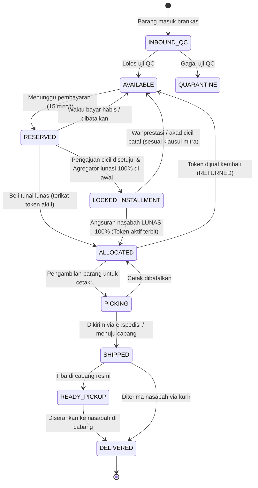
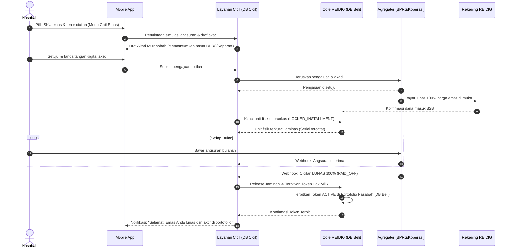

# Spesifikasi Teknis Backend REIDIG (Raja Emas Indonesia Digital)

---

## 1. Tech Stack & Arsitektur Sistem

REIDIG menggunakan pendekatan **Two-Tier Decoupled Architecture (Modular Core + Dedicated Installment Subsystem)** untuk menjaga integritas data kepemilikan emas tunai tetap terisolasi dari proses penagihan dan pembiayaan cicilan:

1. **Core REIDIG Service ("Database Beli")**:
   - Mengelola master data SKU, inventori brankas emas fisik (Jakarta & cabang), penerbitan token kepemilikan sah nasabah, dompet rupiah, transaksi beli/jual tunai (*buyback*), dan pemenuhan cetak fisik.
   - **Database:** PostgreSQL 16 (`reidig_core`).
2. **Installment Service ("Database Cicil")**:
   - Mengelola pengajuan pembiayaan cicilan nasabah, dokumen akad syariah (*Murabahah*), integrasi agregator pembiayaan pihak ketiga (BPRS / Koperasi Syariah), jadwal angsuran bulanan, dan penagihan berkala.
   - **Database:** PostgreSQL 16 (`reidig_installment`).

- **Bahasa & Framework:** Python 3.12+, FastAPI, Pydantic v2, SQLAlchemy 2.0, Alembic
- **Cache & Task Queue:** Redis 7, Celery 5

Struktur direktori utama di dalam `app/`:

```text
app/
  catalog/        # Master data SKU dan lini produk
  pricing/        # Tarik harga, riwayat harga, dan penguncian harga (quote)
  inventory/      # Manajemen keping fisik brankas, penerimaan, QC, opname, jaminan cicilan
  tokens/         # Siklus hidup token kepemilikan sah dan rantai audit hash
  orders/         # Transaksi jual-beli emas tunai
  payments/       # Integrasi payment gateway (inbound) dan pencairan dana (outbound)
  wallet/         # Saldo pengguna, top-up, dan penarikan dana
  fulfillment/    # Permintaan cetak fisik, pengiriman ekspedisi, dan ambil di cabang
  financing/      # Integrasi pembiayaan cicilan dengan agregator pihak ketiga
  identity/       # Profil pengguna, KYC, PIN, dan rekening bank
  ledger/         # Pembukuan akuntansi double-entry internal
  admin/          # Role-Based Access Control (RBAC) dan log audit operasional
  reconciliation/ # Job pencocokan stok fisik, saldo ledger, dan transaksi eksternal
```

### Konvensi Data (Wajib Dipatuhi)
Untuk menghindari *bug* pembulatan desimal (*floating-point error*), seluruh nilai uang dan berat disimpan sebagai bilangan bulat:
- **Rupiah:** Gunakan `integer` tanpa desimal. Saat dikirim lewat JSON, bungkus sebagai `string` (contoh: `"1450000"`) agar aman di sisi klien.
- **Berat Emas:** Gunakan `integer` dalam satuan **miligram** (`0,1 gr = 100`, `1 gr = 1000`, `1 kg = 1000000`). **Dilarang keras memakai `float`.**
- **Waktu:** Selalu simpan dan kirim dalam zona waktu **UTC** dengan format ISO 8601.

---

## 2. Konsep Inti Domain

| Konsep | Penjelasan |
|---|---|
| **SKU** | Katalog jenis produk berdasarkan berat dan lini merek. Dikelola oleh tim gudang melalui dashboard operasional. |
| **Unit Fisik** | Keping emas fisik nyata dengan nomor seri unik (*serial number*). Disimpan terpusat di brankas pusat Jakarta dan dilindungi sistem audit ganda. |
| **Token Digital** | Bukti kepemilikan digital sah di **Database Beli** yang mengunci tepat **satu Unit fisik**. Token terbit saat pembelian tunai lunas atau saat kontrak cicilan dinyatakan lunas 100% oleh agregator pembiayaan. |
| **Keping Jaminan Cicilan** | Keping fisik emas di brankas yang statusnya terkunci (`LOCKED_INSTALLMENT`) karena telah dilunasi di awal oleh mitra pembiayaan, menunggu nasabah menyelesaikan seluruh angsuran di **Database Cicil**. |
| **Agregator & Lembaga Syariah** | Pihak ketiga penyedia dana pembiayaan (BPRS / Koperasi Simpan Pinjam Syariah) yang bekerjasama melalui agregator resmi. Identitas lembaga ini dicantumkan secara legal pada dokumen akad digital, sementara menu aplikasi tetap berkonsep *white-label*. |
| **Quote** | Harga beli atau jual yang dikunci sementara (memiliki batas waktu/TTL) sebagai acuan transaksi. |
| **Saldo Dompet** | Dana Rupiah milik pengguna di dalam aplikasi yang selalu dihitung dari mutasi *ledger* double-entry. |

**Format ID Token:**  
`RET-<kode SKU>-<10 karakter acak Crockford Base32><1 check digit Luhn mod 32>`  
*(Contoh: `RET-LMRE1G-7K3M9QXT4P2`)*

---

## 3. Aturan Emas / Invarian Sistem (Wajib Diuji)

1. **Satu Unit, Maksimal Satu Hak Aktif:** Satu keping fisik hanya boleh memiliki maksimal satu token kepemilikan aktif atau satu jaminan cicilan berjalan (dijaga dengan *partial unique index* di database).
2. **Keterkaitan 1-ke-1:** Setiap token aktif wajib menunjuk ke tepat satu keping fisik nyata yang sedang dikunci di brankas.
3. **Kemurnian Stok Tersedia:** Unit berstatus `AVAILABLE` tidak boleh terikat pada token aktif maupun kontrak cicilan mana pun.
4. **Keseimbangan Stok & Kepemilikan:** Jumlah keping berstatus `ALLOCATED` + `PICKING` + `SHIPPED` + `READY_PICKUP` + `LOCKED_INSTALLMENT` harus selalu sama persis dengan total hak digital dan jaminan cicilan aktif.
5. **Tanpa Stok Fiktif:** Sistem dilarang menjual stok kosong. Unit baru bisa dijual atau dicicil setelah fisik barang diterima gudang dan lolos verifikasi mutu (QC).
6. **Imutabilitas Status Akhir:** Token yang sudah mencapai status final (`RETURNED`, `PRINTED`, `CANCELLED`) tidak bisa diaktifkan kembali.
7. **Jejak Audit Utuh:** Setiap mutasi status fisik maupun token wajib menghasilkan *event log* yang bersifat *append-only* dengan rantai hash (*audit trail*).
8. **Keseimbangan Akuntansi:** Setiap jurnal pembukuan di *ledger* harus selalu berimbang (`Total Debit = Total Kredit`).
9. **Anti Saldo Minus:** Saldo tersedia (*available balance*) pengguna tidak boleh pernah bernilai negatif (`CHECK (available >= 0)`).
10. **Kecukupan Dana Pengguna:** Total seluruh saldo pengguna di aplikasi wajib tertutup penuh oleh dana nyata di rekening penampungan (*escrow bank*).

---

## 4. Siklus Status (State Machine)

### 4.1 Siklus Hidup Token & Kepemilikan (Database Beli)


### 4.2 Siklus Hidup Unit Fisik di Brankas



---

## 5. Desain Skema Database

### 5.1 Skema Database Beli / Core REIDIG (`reidig_core`)

```sql
CREATE TABLE skus (
  id BIGSERIAL PRIMARY KEY,
  code TEXT UNIQUE NOT NULL,
  brand TEXT NOT NULL,
  weight_mg BIGINT NOT NULL CHECK (weight_mg > 0),
  is_active BOOLEAN NOT NULL DEFAULT TRUE
);

CREATE TABLE units (
  id BIGSERIAL PRIMARY KEY,
  sku_id BIGINT NOT NULL REFERENCES skus(id),
  serial_number TEXT NOT NULL,
  location_id BIGINT NOT NULL REFERENCES locations(id),
  bin_location TEXT,
  -- Status: INBOUND_QC, AVAILABLE, RESERVED, ALLOCATED, LOCKED_INSTALLMENT, PICKING, SHIPPED, READY_PICKUP, DELIVERED, QUARANTINE, WRITTEN_OFF
  status TEXT NOT NULL,
  version INT NOT NULL DEFAULT 0,
  UNIQUE (sku_id, serial_number)
);
CREATE INDEX idx_units_available ON units (sku_id, id) WHERE status = 'AVAILABLE';

CREATE TABLE tokens (
  id UUID PRIMARY KEY,
  token_code TEXT UNIQUE NOT NULL,
  user_id BIGINT NOT NULL REFERENCES users(id),
  unit_id BIGINT NOT NULL REFERENCES units(id),
  sku_id BIGINT NOT NULL REFERENCES skus(id),
  status TEXT NOT NULL, -- ACTIVE, PRINT_PENDING, RETURNED, PRINTED, CANCELLED
  acquired_price BIGINT NOT NULL,
  origin_type TEXT NOT NULL, -- 'ORDER', 'INSTALLMENT_COMPLETED'
  origin_id BIGINT NOT NULL,
  created_at TIMESTAMPTZ NOT NULL DEFAULT now(),
  closed_at TIMESTAMPTZ
);
CREATE UNIQUE INDEX uq_unit_one_open_token ON tokens (unit_id)
  WHERE status NOT IN ('RETURNED', 'PRINTED', 'CANCELLED');

CREATE TABLE installment_collateral_locks (
  id BIGSERIAL PRIMARY KEY,
  contract_ref VARCHAR(32) UNIQUE NOT NULL,
  unit_id BIGINT NOT NULL REFERENCES units(id),
  sku_id BIGINT NOT NULL REFERENCES skus(id),
  user_id BIGINT NOT NULL REFERENCES users(id),
  aggregator_code VARCHAR(32) NOT NULL,
  upfront_payment_ref VARCHAR(64) NOT NULL,
  status VARCHAR(24) NOT NULL, -- 'LOCKED', 'RELEASED_TO_BUY_DB', 'LIQUIDATED'
  locked_at TIMESTAMPTZ NOT NULL DEFAULT now(),
  released_at TIMESTAMPTZ
);
```

### 5.2 Skema Database Cicil (`reidig_installment`)

```sql
CREATE TABLE financing_institutions (
  id SERIAL PRIMARY KEY,
  code VARCHAR(32) UNIQUE NOT NULL,             -- 'BPRS_HIK', 'KSPPS_BMT'
  legal_name VARCHAR(128) NOT NULL,             -- 'PT BPRS Harta Insan Karimah'
  license_number VARCHAR(64) NOT NULL,          -- Nomor izin OJK / Kemenkop
  aggregator_partner VARCHAR(64) NOT NULL,      -- Nama agregator
  is_active BOOLEAN DEFAULT TRUE,
  created_at TIMESTAMPTZ DEFAULT now()
);

CREATE TABLE installment_agreement_templates (
  id SERIAL PRIMARY KEY,
  version VARCHAR(32) UNIQUE NOT NULL,
  institution_id INT REFERENCES financing_institutions(id),
  title VARCHAR(128) NOT NULL,                  -- 'Akad Pembiayaan Murabahah Emas'
  body_markdown TEXT NOT NULL,
  content_hash VARCHAR(64) NOT NULL,
  is_current BOOLEAN DEFAULT FALSE,
  created_at TIMESTAMPTZ DEFAULT now()
);

CREATE TABLE installment_applications (
  id BIGSERIAL PRIMARY KEY,
  application_ref VARCHAR(32) UNIQUE NOT NULL,
  core_user_id BIGINT NOT NULL,
  sku_code VARCHAR(32) NOT NULL,
  weight_mg INT NOT NULL,
  gold_cash_price BIGINT NOT NULL,
  down_payment BIGINT DEFAULT 0,
  principal_financed BIGINT NOT NULL,
  tenor_months INT NOT NULL,
  monthly_installment BIGINT NOT NULL,
  status VARCHAR(24) NOT NULL,                  -- 'PENDING_APPROVAL', 'APPROVED', 'REJECTED', 'CANCELLED'
  created_at TIMESTAMPTZ DEFAULT now()
);

CREATE TABLE installment_contracts (
  id BIGSERIAL PRIMARY KEY,
  contract_ref VARCHAR(32) UNIQUE NOT NULL,     -- 'CTR-20261105-001'
  application_id BIGINT UNIQUE REFERENCES installment_applications(id),
  core_user_id BIGINT NOT NULL,
  institution_id INT REFERENCES financing_institutions(id),
  locked_unit_serial VARCHAR(64) NOT NULL,
  total_months INT NOT NULL,
  paid_months INT DEFAULT 0,
  status VARCHAR(24) NOT NULL DEFAULT 'ACTIVE', -- 'ACTIVE', 'PAID_OFF', 'TRANSFERRED', 'DEFAULTED'
  full_settlement_date TIMESTAMPTZ,
  created_at TIMESTAMPTZ DEFAULT now()
);

CREATE TABLE installment_schedules (
  id BIGSERIAL PRIMARY KEY,
  contract_id BIGINT REFERENCES installment_contracts(id),
  installment_no INT NOT NULL,
  due_date DATE NOT NULL,
  amount BIGINT NOT NULL,
  status VARCHAR(16) NOT NULL DEFAULT 'UNPAID', -- 'UNPAID', 'PAID', 'OVERDUE'
  paid_at TIMESTAMPTZ,
  payment_reference VARCHAR(64)
);
```

---

## 6. Alur Bisnis Utama

### 6.1 Pembelian Emas Tunai (Buy)
1. Klien memanggil `POST /v1/quotes` untuk mengunci harga acuan (TTL 60 detik).
2. Klien memanggil `POST /v1/orders/buy`. Dalam **satu transaksi database**:
   - Kunci unit fisik `AVAILABLE` dengan `FOR UPDATE SKIP LOCKED`.
   - Potong saldo atau terbitkan invoice payment gateway (15 menit).
   - Setelah lunas, unit menjadi `ALLOCATED` dan token digital kepemilikan sah (`ACTIVE`) diterbitkan.

### 6.2 Penjualan Emas Tunai / Buyback (Sell)
1. Klien meminta quote harga jual.
2. Memanggil `POST /v1/orders/sell` dengan otorisasi PIN.
3. Kunci token, ubah status menjadi `RETURNED`, unit fisik kembali `AVAILABLE`, dan dana hasil penjualan masuk ke saldo dompet pengguna secara instan dan atomik.

### 6.2a Manajemen Saldo & Penarikan Dana (Withdrawal)
1. Klien memanggil `POST /v1/wallet/withdrawals` dengan otorisasi PIN.
2. Dalam satu transaksi: pastikan saldo mencukupi, pindahkan saldo dari `available` ke `held` (*lock for withdrawal*), dan buat record penarikan dengan status `PROCESSING`.
3. Instruksi transfer dikirim ke bank rekanan / disbursement gateway.
4. Jika transfer berhasil: potong saldo `held` dan ubah status menjadi `SUCCESS`.
5. Jika transfer gagal: kembalikan saldo `held` ke `available` dan tandai `FAILED`.
6. Jika status tidak jelas (`UNKNOWN`): dana tetap ditahan di `held` hingga staf Finance melakukan verifikasi mutasi rekening koran bank.

### 6.3 Cicilan Emas Melalui Agregator & Lembaga Syariah (BPRS / Koperasi Syariah)

Fitur cicil dirancang dengan prinsip **kemitraan syariah, settlement penuh di muka, dan white-label UI**:



1. **Tampilan Menu (*White-Label UI*)**:
   - Menu di aplikasi mobile tetap bertuliskan **"Cicil Emas"** dengan tampilan bersih dan elegan tanpa logo bank pihak ketiga.
2. **Akad Pembiayaan Murabahah (*Agreement*)**:
   - Kemitraan lembaga keuangan syariah mitra (**PT BPRS / Koperasi Simpan Pinjam Syariah**) dan agregator resmi **hanya dicantumkan pada lembar dokumen akad digital**.
   - Nasabah menyetujui akad pembiayaan jual-beli pesanan (*Murabahah*) secara sadar dan sah.
3. **Pelunasan Penuh di Muka oleh Agregator (*100% Upfront Settlement*)**:
   - Saat pengajuan disetujui, pihak ketiga/agregator melunasi harga emas fisik 100% langsung ke rekening penampungan REIDIG.
   - REIDIG menerima kas penuh sejak hari pertama.
4. **Jaminan Fisik di Brankas**:
   - Keping fisik emas di brankas REIDIG di-lock dengan status **`LOCKED_INSTALLMENT`**.
   - Keping ini dijamin tidak akan dipindahtangankan, dijual, atau dicetak selama masa angsuran.
5. **Masa Angsuran Nasabah**:
   - Nasabah membayar angsuran bulanan ke agregator sesuai jadwal di **Database Cicil**.
   - Pada aplikasi, nasabah memantau progres pembayaran di tab *"Cicilan Berjalan"*.
6. **Migrasi Hak Milik Saat Lunas (*Transfer to Buy DB*)**:
   - Begitu angsuran terakhir terverifikasi lunas (`PAID_OFF`), agregator mengirim webhook penyelesaian.
   - Layanan Cicil memanggil Core API: keping fisik bertransisi menjadi `ALLOCATED` dan **Token Emas Digital Resmi (`ACTIVE`)** diterbitkan di akun nasabah pada **Database Beli**.
   - Emas resmi masuk ke saldo portofolio emas nasabah dan dapat disimpan, dijual kembali (*buyback*), atau dicetak fisik.

---

## 7. Keamanan & Kepatuhan Audit

1. **Prinsip Imutabilitas (Append-Only):**
   - Tabel `token_events`, `unit_events`, `wallet_entries`, `ledger_entries`, dan `signed_agreements` dilarang menerima operasi `UPDATE` dan `DELETE`.
2. **Dual-Control Safeguard:**
   - Fitur penghentian perdagangan darurat (*kill switch*) memerlukan personel Treasury/Finance yang berbeda untuk mengaktifkan kembali.
3. **Rekonsiliasi Otomatis (Circuit Breaker):**
   - Job latar belakang memverifikasi kesesuaian unit fisik di brankas vs token aktif dan saldo dompet vs kas penampungan secara berkala. Jika terjadi anomali, sistem otomatis menghentikan transaksi terkait.
